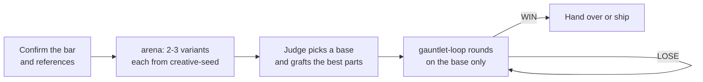

# Development Skills

Reusable development skills for Codex, Claude and OMP. The new workflow and principle skills use portable Markdown instructions; host-specific discovery and tools remain the harness’s responsibility.

## Install with Codex

```bash
codex plugin marketplace add mintuz/skills
```

Restart the ChatGPT desktop app, open the Plugins Directory, choose
**Mintuz Skills**, and install the bundles you need.

## Install with Claude Code

```bash
# Add the marketplace
/plugin marketplace add https://github.com/mintuz/skills

# Install plugins
/plugin install core@mintuz-skills
/plugin install web@mintuz-skills
/plugin install typescript@mintuz-skills
/plugin install system-design@mintuz-skills
/plugin install product-management@mintuz-skills
/plugin install app@mintuz-skills
/plugin install life@mintuz-skills
/plugin install principle@mintuz-skills
```

## Use with OMP or standalone skill loaders

Keep each complete skill directory, including references. For the 54 skills adapted from pstack (7 core workflows and 47 principles), the copier adds [THIRD_PARTY_NOTICES.md](THIRD_PARTY_NOTICES.md) so the MIT notice travels with the bundle. To generate flat directories with the existing copier:

```bash
go run scripts/codex-sync.go --output /path/to/your/skills
```

Point the harness’s skill discovery at that directory, or copy it into its documented skill location. The copier preserves ordinary `SKILL.md` bundles; despite its name it does not translate the instructions into a Codex-only format. Leave `--prefix` off to preserve names such as `principle-prove-it-works`.

Use one authoritative distribution per skill name. Run `omp --help` for the installed version’s discovery/filter options. Portable prose alone is not a runtime certification.

## When to use the main skills

This section covers the entry points and the skills that I use every day. The [Skills](#skills) tables list every other skill. The example prompts come from real Claude Code and OMP sessions. Project names and links are replaced with placeholders.

Each harness calls a skill by name with a different syntax. The examples use the Claude Code form.

| Harness     | Syntax        | Example          |
| ----------- | ------------- | ---------------- |
| Claude Code | `/name`       | `/reducer`       |
| OMP         | `/skill:name` | `/skill:reducer` |
| Codex       | `$name`       | `$reducer`       |

### Pick a skill

| Situation                                                                    | Skill                                  |
| ---------------------------------------------------------------------------- | -------------------------------------- |
| A task needs a full workflow: review, bug fix, spec, implementation, design  | `adam-mode`                            |
| An open "which approach?" question needs an experiment before the real build | `adam-mode` Prototype (spike) playbook |
| One artifact must reach a high, confirmed bar over several rounds            | `gauntlet-loop`                        |
| One artifact can take several shapes, and you want them judged in one pass   | `arena`                                |
| The look of a UI concept is open, and the variants must differ               | `creative-seed`                        |
| Existing code or a system has more moving parts than its behaviour needs     | `reducer`                              |
| New work must stay at the minimum that the requirement needs                 | `yagni`                                |
| You need to know what the code does now                                      | `how`                                  |
| You need to know why the code exists in its current form                     | `why`                                  |

### `adam-mode`

`adam-mode` is the main entry point. It is manual-only, so call it by name. It matches the request to a playbook, loads the skills that the playbook needs, delegates to `adam-agent` and proves the result before it reports. It continues without asking on reversible work, such as branches, commits, PRs and CI repair. It stops before a merge, the auto-merge label, a force-push, a data deletion or a message to a person, unless you asked for that action in the session.

| Request                                                          | Playbook     |
| ---------------------------------------------------------------- | ------------ |
| "Review this PR"                                                 | Review       |
| "Implement spec 013" or "Make the fixes that you recommended"    | Implement    |
| "I have received a bug report"                                   | Bug fix      |
| "How does…", "Why does…", "Explain…" or "Are you sure?"          | Investigate  |
| "Redesign this from first principles with fewer moving parts"    | Rethink      |
| "Make this faster"                                               | Perf         |
| "Continue, my device crashed"                                    | Resume       |
| "Spike this" or "Prototype this"                                 | Prototype    |
| "The disk is full" or "Remove old worktrees"                     | Disk         |
| "Make this match the mock-up"                                    | Match design |
| "Write a spec" or "Create visual Given/When/Thens for this spec" | Spec         |
| "Make this screen world class"                                   | Design loop  |
| "Make CI go green"                                               | Ship         |

```text
/adam-mode Review this PR: <PR URL>. Restate what we are trying to achieve, then consider the solution from first principles. Optimise for simplicity and reduced complexity.
/adam-mode I have received a bug report. Validate that it is a real issue, diagnose it and suggest a fix. [screenshot]
/adam-mode Create visual Given/When/Thens for this spec: <PR URL>
/adam-mode Start the implementation of spec 013. Optimise for simplicity and reduced complexity.
/adam-mode Make CI go green and add the auto-merge label.
```

### Prototype (spike)

Prototype is a playbook in `adam-mode`, not a separate skill. "Spike" and "prototype" start the same playbook. Use it when a library choice, a layout, a feature, a product or a bug fix has more than one possible approach, and an experiment can settle the choice. The output is a decision and its evidence. The prototype code is throwaway and never ships.

- One open decision gets labelled variants behind one switcher, inside the running app.
- Several open questions get whole versions. `arena` builds and judges them, and short `gauntlet-loop` rounds improve the chosen base. The result is a keep list for the real build.

Do not use it when the spec already fixes the approach. For a bug, confirm the root cause first: a prototype compares fixes, not causes.

```text
/adam-mode Spike a solution for this and give me code examples. It must work with our existing auto-layout algorithm.
/adam-mode I have a prototype in main. Build another prototype on top of it as a Tauri app.
/adam-mode Continue the spec generation. Consider the architecture, spike the hard parts and put the implementation details in the spec.
```

### `gauntlet-loop`

Use `gauntlet-loop` when one artifact must reach a high bar and you expect several rounds: a screen, a flow, a visual language, a document or a system check. Separate builders make each round. A fresh critic gives each round a verdict of WIN, LOSE or UNJUDGEABLE against the bar.

The skill asks you to confirm the bar before round 1. Give it something that a critic can inspect: a screenshot, a production URL, a reference app, Mobbin screens or a checkable condition. "World class" alone is not a bar; the skill turns it into concrete criteria for you to confirm.

Do not use it for routine changes that have clear acceptance tests, or to choose between different shapes in one pass (use `arena`).

```text
/gauntlet-loop Redesign the History view. It must be glanceable and show what a user wants to know about past sessions. Use Mobbin for inspiration.
The spacing, line height and padding of the Insights tab need polish. The screenshot shows where it is cluttered. Use /gauntlet-loop and Mobbin.
The site layout looks broken compared to production at <URL>. Use /gauntlet-loop with production and Mobbin as references to redesign it.
Do the previous task with /gauntlet-loop. The WIN is when every contradiction is removed or updated.
```

### `arena`

Use `arena` when a non-trivial artifact can take several shapes, and a single first attempt would lock in one shape: an interface, a module design, a prompt, a document or a visual direction. It produces two or more independent candidates, judges them against one rubric, picks a base and grafts the best parts of the others into it. `architect`, the Prototype playbook and the Design loop playbook all use `arena`.

Do not use it for a task with one obvious answer, or to raise one artifact to a bar over several rounds (use `gauntlet-loop`).

```text
Use /arena to draft three shapes of the CSV import API. Judge them on caller simplicity, error handling and testability, then graft the best parts into one.
Use /arena with three candidates for the onboarding copy. Rubric: plain UK English, under 40 words, no jargon.
/architect the sync module before we build it.
```

`arena` and `gauntlet-loop` answer different questions. Use `arena` first when the direction is open, then `gauntlet-loop` to raise the chosen direction to the bar.

|          | `arena`                                       | `gauntlet-loop`                                     |
| -------- | --------------------------------------------- | --------------------------------------------------- |
| Question | Which shape is best?                          | Is this shape good enough yet?                      |
| Passes   | One                                           | Repeated rounds, until the evidence supports a stop |
| Input    | The task, shared paths and a rubric           | One artifact and a bar that you confirm             |
| Output   | One synthesised artifact and a synthesis note | One artifact, with a verdict for each round         |

### `creative-seed`

Use `creative-seed` when you ask for UI concepts, prototype designs or exploratory visual variants whose look is open. Each variant gets a label, for example `settings-concept/B`. A script turns the label into a long string of letters and digits. The agent reads patterns in the string and derives the colour scheme, layout and typography from them. The design never shows the string. The same label always gives the same string, so you can regenerate a direction later.

Do not use it to match an agreed mock-up, or in repair rounds on a design that you already picked. Those rounds keep the pinned direction.

```text
Build three concepts for the settings screen. Use /creative-seed to set the direction of each concept.
I like concept B, but not its colours. Reroll concept B with /creative-seed.
```

A reroll keeps the label and adds a number, for example `settings-concept/B/2`.

### `reducer`

Use `reducer` when an existing system, feature or PR has more moving parts than its behaviour needs: branches, state, dependencies, layers or hand-written scripts. It records every supported behaviour in a behaviour ledger, derives the minimum mechanism from first principles and proves that the behaviour does not change. It can diagnose only (a design with no edits) or implement the change in reversible slices.

Do not use it to remove features. Removing a supported behaviour is a scope change that needs an owner decision.

```text
Use /reducer on the changes that we have made.
This repo provisions my machines with make, Ansible, shell scripts and Homebrew. Go back to first principles. How can I reduce the number of moving parts?
/speckit-plan Use /reducer to find code and patterns that we can reuse instead of building new ones.
```

### `yagni`

Use `yagni` when you change production code, especially when you implement a spec or a user story. Before it executes, it states a minimal plan: the goal, the non-goals, the acceptance criteria and what stays untouched. It writes the failing test first. It asks for a missing requirement and does not guess it.

Do not use it to remove complexity from existing code (use `reducer`). `yagni` stops new complexity; `reducer` removes complexity that is already there. Load both for most implementation and review work.

```text
Implement spec 002 on a new branch against ios27. Use speckit, /yagni, /swiftui-architecture and /app-intent-driven-development.
Review the architecture of the changes that we have made. Use /yagni and /reducer. Look for ways to reduce and flatten complexity and deepen modules. More code is not always better.
```

### `how` and `why`

Use `how` to explain what the code does now: the execution path and the owner of each piece of state. Use `why` to recover the reason that the code exists in its current form. `why` labels each finding as fact, inference or unknown. Both skills are read-only. `teach` combines them into one plain explanation.

```text
/how does XState connect to the new CanvasSurface?
/how What is the live-channel feature and how does it work? Give code examples with /pseudocode and sequence diagrams.
/why does this custom Python and shell code exist? I want to know if we can remove it and use a framework or tool instead.
/why did we remove that rule? Was a test deleted?
```

### Combined examples

**Review, fix and ship a PR.** `adam-mode` runs the Review, Implement and Ship playbooks in order. Review and Implement use `yagni` and `reducer`; Ship uses `ship-pr` and `babysit`.

```text
/adam-mode Do a deep review of <PR URL>. Look for ways to reduce and flatten complexity. Look for scope creep, features built outside the spec and features deleted without approval. Use /yagni, /reducer, /react, /xstate and /tailwind.
/adam-mode Make the fixes that you recommended.
/adam-mode Make CI go green and add the auto-merge label.
```

**Implement a spec with one sub-agent for each user story.** `yagni` keeps each story to its minimum and `reducer` keeps the integrated result flat.

```text
/goal Implement spec 540 on a new branch as a single PR. Act as coordinator: spawn one sub-agent for each user story and integrate its work. Use /yagni, /reducer, /react, /xstate and /tailwind. After the last story, review the full implementation.
```

**Redesign a screen.** `adam-mode` runs the Design loop playbook. Round 1 runs through `arena`, and `creative-seed` sets the direction of each variant. From round 2, `gauntlet-loop` improves only the chosen base until a fresh critic gives a WIN.



```text
/adam-mode The site layout looks broken compared to production at <URL>. Use /gauntlet-loop with production and Mobbin as references to redesign it.
```

**Spike a new platform feature.** `adam-mode` runs the Prototype playbook. `arena` builds the variants, `creative-seed` sets their look, and `gauntlet-loop` improves the base. The output is a decision document, not shippable code.

```text
/adam-mode The iPhone Duo is coming out. Read the documentation on how to support it, spike the solution, and use /gauntlet-loop with Mobbin to build different UI variants. Write a document of what we should change, with screenshots of the variants.
```

**Understand, then simplify.** Use `how` for the current behaviour, `why` for the reason behind it and `reducer` for the smaller design. Add `blast-radius` to see what a change can break.

```text
/how What does the new useEffect in <file> do?
/why does it exist, and what are the alternatives? Use /blast-radius for each alternative.
/reducer Can we remove it without a change in behaviour?
```

## Plugins

| Plugin                 | Description                                                                                  |
| ---------------------- | -------------------------------------------------------------------------------------------- |
| **core**               | Core workflows: commits, learning, code review, prompts, PRs, writing, and persistent memory |
| **web**                | Web development with CSS, React, Tailwind, TDD, testing, and design patterns                 |
| **typescript**         | TypeScript strict mode, schema-first development, and best practices                         |
| **system-design**      | Architecture visualization with Mermaid diagrams                                             |
| **product-management** | PRDs, task management with Task Master MCP, decision tracing, and status updates             |
| **app**                | Swift iOS development with App Intents, Swift Testing, and SwiftUI architecture              |
| **principle**          | 54 independent engineering principles, each invoked for a specific decision                  |
| **life**               | Personal life management with GPS method for goal achievement                                |

## Skills

### Core

| Skill                       | Description                                                                                               |
| --------------------------- | --------------------------------------------------------------------------------------------------------- |
| `acceptance-review`         | Verify implementation against an authoritative contract with an explicit verdict                          |
| `commit-messages`           | Conventional commit messages that explain the "why" not just the "what"                                   |
| `yagni`                     | Minimum sufficient execution, scope boundaries, TDD, and documentation practices                          |
| `gauntlet-loop`             | Improve ambitious artifacts against a concrete bar using separate builders and fresh critics              |
| `graph-engineering`         | Orchestrate interdependent specs and stories as a contract-first execution graph with a verifier per node |
| `record-lesson`             | Record a verified project lesson as the smallest rule in AGENTS.md or CLAUDE.md                           |
| `pr`                        | PR descriptions, sizing, and creation with gh CLI                                                         |
| `pseudocode`                | Render module boundaries, signatures, arguments, and a cited call graph for existing or planned code      |
| `reducer`                   | First-principles system simplification with behavioral equivalence proofs                                 |
| `ship-pr`                   | Commit, publish, repair, and monitor a GitHub pull request through merge                                  |
| `writing`                   | Developer-focused writing: tutorials, how-tos, docs with clear structure                                  |
| `wtf`                       | Re-explain an unclear response in plain, precise UK English                                               |
| `create-verification-skill` | Create and cold-replay one critical user-journey check                                                    |
| `blast-radius`              | Trace material change risks and decisive checks                                                           |
| `how`                       | Explain the current execution path and state ownership                                                    |
| `why`                       | Recover rationale while separating fact, inference and unknown                                            |
| `benchmark-checklist`       | Check measurement correctness, repeatability and interpretation                                           |
| `correct`                   | Turn recurring enforceable mistakes into verified structural guards                                       |
| `recall`                    | Recover bounded past context and reconcile it with current evidence                                       |
| `adam-mode`                 | Manual-only. Route a task to Adam's playbooks, principles and skills, and delegate through `adam-agent`   |
| `teach`                     | Manual-only. Explain a change or subsystem plainly, using `how` and `why`, at the reader's pace           |
| `architect`                 | Sketch types, signatures and modules through `arena`, then implement against the agreed sketch           |
| `arena`                     | Run independent attempts at one task, judge them on a rubric, pick a base and graft the best parts       |
| `sharpen`                   | Manual-only. Make a task deeper, not bigger, then rewrite the prompt                                      |
| `in-your-own-words`         | Manual-only. Restate the user's goals and the problem they are trying to solve                            |
| `creative-seed`             | Derive each UI concept's creative direction from a deterministic seed string that the design never shows  |

### Web

| Skill              | Description                                                               |
| ------------------ | ------------------------------------------------------------------------- |
| `css`              | CSS best practices for maintainable, scalable styles                      |
| `react`            | Production-ready React architecture and patterns                          |
| `xstate`           | Typed XState actor lifecycles with legal Mermaid statechart visualization |
| `react-testing`    | React Testing Library patterns for components, hooks, and context         |
| `frontend-testing` | DOM Testing Library patterns for behavior-driven UI testing               |
| `tdd`              | Test-Driven Development principles and Red-Green-Refactor workflow        |
| `refactoring`      | Refactoring assessment and patterns after tests pass                      |
| `web-design`       | Visual hierarchy, spacing, typography, and UI polish                      |
| `tailwind`         | Design systems with Tailwind CSS, design tokens, and component libraries  |
| `eyes`             | Visual feedback loop with Playwright screenshots for UI iteration         |
| `chatgpt-app-sdk`  | Build ChatGPT apps using OpenAI Apps SDK and MCP with conversational UX   |

### App

| Skill                           | Description                                                                                     |
| ------------------------------- | ----------------------------------------------------------------------------------------------- |
| `swift-testing`                 | Swift Testing framework: @Test macros, #expect/#require patterns                                |
| `app-intent-driven-development` | Build features as App Intents first for Siri, Shortcuts, widgets, and SwiftUI                   |
| `swiftui-architecture`          | Modern SwiftUI patterns: @Observable, state management, no ViewModels                           |
| `debug`                         | Structured feedback loop for debugging iOS simulator issues and UI problems                     |
| `local-ai-models`               | On-device AI with Foundation Models and MLX Swift: LLMs, VLMs, embeddings, and image generation |
| `app-store-scraper`             | Scrape iOS/macOS App Store data using iTunes/App Store APIs                                     |
| `app-store-keyword-ops`         | Mine Astro competitor keywords and safely update locale-specific App Store fields               |
| `ios-localize-copy`             | Localize iOS and App Store copy across every supported locale                                   |
| `xcode-dev-loop`                | Canonical xcodebuild build/test/simulator loop: background runs, result reading, screenshots    |
| `asc-screenshots`               | Upload App Store screenshots and previews through helm-asc: staging, locales, verification      |

### TypeScript

| Skill        | Description                                                           |
| ------------ | --------------------------------------------------------------------- |
| `typescript` | Schema-first development, strict typing, functional patterns, and Zod |

### Life

| Skill        | Description                                                                        |
| ------------ | ---------------------------------------------------------------------------------- |
| `gps-method` | Evidence-based goal achievement framework using Goal, Plan, and System methodology |

### System Design

| Skill               | Description                                                                     |
| ------------------- | ------------------------------------------------------------------------------- |
| `mermaid-generator` | Generate Mermaid diagrams from code to visualize architecture and relationships |

### Product Management

| Skill                     | Description                                                                            |
| ------------------------- | -------------------------------------------------------------------------------------- |
| `decision-trace`          | Trace claimed decisions from source evidence through delivery artifacts                |
| `meeting-to-action-brief` | Turn meeting evidence into a concise decision and action brief                         |
| `status-updates`          | Team updates and stakeholder comms with scannable structure and honest tone            |
| `story-pr-orchestrator`   | Coordinate dependency-gated stories through isolated pull requests                     |
| `design-handover`         | Explicitly transfer accepted behaviour, matching visuals, authority and durable assets |

## Principles

Each is an independent skill under `src/principle/skills/`, with its full `principle-*` name. Invoke the one relevant to the decision; no router or global principle mode is required.

| Skill | Focus |
| ----- | ----- |
| [`principle-attack-the-premise`](src/principle/skills/principle-attack-the-premise/SKILL.md) | Challenge assumptions shared by failed approaches. |
| [`principle-build-the-lever`](src/principle/skills/principle-build-the-lever/SKILL.md) | Automate repeated work when reuse earns it. |
| [`principle-capture-the-baseline`](src/principle/skills/principle-capture-the-baseline/SKILL.md) | Record the before state before changing it. |
| [`principle-clean-up-what-you-started`](src/principle/skills/principle-clean-up-what-you-started/SKILL.md) | Release only owned resources; keep the evidence. |
| [`principle-define-done`](src/principle/skills/principle-define-done/SKILL.md) | Give every deliverable a checkable completion criterion. |
| [`principle-derive-from-one-owner`](src/principle/skills/principle-derive-from-one-owner/SKILL.md) | One owner per fact; derive the rest. |
| [`principle-earn-every-element`](src/principle/skills/principle-earn-every-element/SKILL.md) | Justify each control or option by a user need. |
| [`principle-encode-lessons-in-structure`](src/principle/skills/principle-encode-lessons-in-structure/SKILL.md) | Turn verified lessons into structural constraints. |
| [`principle-exhaust-the-design-space`](src/principle/skills/principle-exhaust-the-design-space/SKILL.md) | Compare alternatives for material uncertainty. |
| [`principle-experience-first`](src/principle/skills/principle-experience-first/SKILL.md) | Start from the observed user journey. |
| [`principle-explain-the-number`](src/principle/skills/principle-explain-the-number/SKILL.md) | Report numbers with method and class-matched evidence. |
| [`principle-fix-root-causes`](src/principle/skills/principle-fix-root-causes/SKILL.md) | Repair the mechanism; rerun the original failure. |
| [`principle-fix-the-bar-first`](src/principle/skills/principle-fix-the-bar-first/SKILL.md) | Fix selection criteria before evaluating candidates. |
| [`principle-foundational-thinking`](src/principle/skills/principle-foundational-thinking/SKILL.md) | Build a foundation only when current work needs it. |
| [`principle-gaps-are-not-passes`](src/principle/skills/principle-gaps-are-not-passes/SKILL.md) | Report skipped or failed checks as gaps. |
| [`principle-guard-the-context-window`](src/principle/skills/principle-guard-the-context-window/SKILL.md) | Read in bounded slices; search before loading. |
| [`principle-hide-representations`](src/principle/skills/principle-hide-representations/SKILL.md) | Expose domain concepts, not wire or storage shapes. |
| [`principle-investigate-read-only`](src/principle/skills/principle-investigate-read-only/SKILL.md) | An investigation changes nothing it studies. |
| [`principle-judge-with-fresh-eyes`](src/principle/skills/principle-judge-with-fresh-eyes/SKILL.md) | Builders never give the acceptance verdict. |
| [`principle-keep-secrets-out`](src/principle/skills/principle-keep-secrets-out/SKILL.md) | Keep credentials out of output and repositories. |
| [`principle-keep-the-core-pure`](src/principle/skills/principle-keep-the-core-pure/SKILL.md) | Pure domain decisions; thin framework wiring. |
| [`principle-label-the-evidence`](src/principle/skills/principle-label-the-evidence/SKILL.md) | Mark each claim's status, evidence level and source. |
| [`principle-lead-with-the-answer`](src/principle/skills/principle-lead-with-the-answer/SKILL.md) | Put the answer first, background after. |
| [`principle-make-operations-idempotent`](src/principle/skills/principle-make-operations-idempotent/SKILL.md) | Handle retries, interruptions and owned cleanup. |
| [`principle-migrate-callers-then-delete-legacy-apis`](src/principle/skills/principle-migrate-callers-then-delete-legacy-apis/SKILL.md) | Prove consumer coverage before deleting APIs. |
| [`principle-minimize-reader-load`](src/principle/skills/principle-minimize-reader-load/SKILL.md) | Collapse layers that own no decision. |
| [`principle-model-the-domain`](src/principle/skills/principle-model-the-domain/SKILL.md) | Represent legal states, transitions and ownership. |
| [`principle-narrow-state-lifetime`](src/principle/skills/principle-narrow-state-lifetime/SKILL.md) | Keep mutable state request-owned and short-lived. |
| [`principle-never-block-on-the-human`](src/principle/skills/principle-never-block-on-the-human/SKILL.md) | Continue authorized independent work. |
| [`principle-never-weaken-a-check`](src/principle/skills/principle-never-weaken-a-check/SKILL.md) | Never loosen a gate just to pass. |
| [`principle-observe-dont-infer`](src/principle/skills/principle-observe-dont-infer/SKILL.md) | Observe effects instead of trusting names. |
| [`principle-outcome-oriented-execution`](src/principle/skills/principle-outcome-oriented-execution/SKILL.md) | Converge on the accepted end state. |
| [`principle-parse-at-the-boundary`](src/principle/skills/principle-parse-at-the-boundary/SKILL.md) | Parse untrusted input where trust changes. |
| [`principle-preserve-meaning`](src/principle/skills/principle-preserve-meaning/SKILL.md) | Keep conditions and uncertainty when compressing. |
| [`principle-preserve-unrelated-work`](src/principle/skills/principle-preserve-unrelated-work/SKILL.md) | Leave behaviour and edits you weren't asked to change. |
| [`principle-price-each-option`](src/principle/skills/principle-price-each-option/SKILL.md) | State each option's effect and cost. |
| [`principle-prove-it-works`](src/principle/skills/principle-prove-it-works/SKILL.md) | Verify the claim on the identified artifact. |
| [`principle-rank-sources-by-authority`](src/principle/skills/principle-rank-sources-by-authority/SKILL.md) | Settle conflicting sources by authority, not recency. |
| [`principle-redesign-from-first-principles`](src/principle/skills/principle-redesign-from-first-principles/SKILL.md) | Derive a scoped design from real constraints. |
| [`principle-refresh-before-resuming`](src/principle/skills/principle-refresh-before-resuming/SKILL.md) | Re-check changed state before relying on a handover. |
| [`principle-report-every-transition`](src/principle/skills/principle-report-every-transition/SKILL.md) | Report state changes without being asked. |
| [`principle-reuse-before-building`](src/principle/skills/principle-reuse-before-building/SKILL.md) | Use an existing mechanism before creating one. |
| [`principle-scale-verification`](src/principle/skills/principle-scale-verification/SKILL.md) | Run required checks; add more in proportion to risk. |
| [`principle-separate-before-serializing-shared-state`](src/principle/skills/principle-separate-before-serializing-shared-state/SKILL.md) | Separate independent state while preserving atomic invariants. |
| [`principle-sequence-verifiable-units`](src/principle/skills/principle-sequence-verifiable-units/SKILL.md) | Pass each unit's check before dependent work. |
| [`principle-state-the-claim-first`](src/principle/skills/principle-state-the-claim-first/SKILL.md) | Write the falsifiable claim before working. |
| [`principle-state-the-scope`](src/principle/skills/principle-state-the-scope/SKILL.md) | Restate broad requests; never narrow them silently. |
| [`principle-stay-in-scope`](src/principle/skills/principle-stay-in-scope/SKILL.md) | Act only within the authority granted. |
| [`principle-subtract-before-you-add`](src/principle/skills/principle-subtract-before-you-add/SKILL.md) | Remove proven redundancy before adding. |
| [`principle-test-behavior-not-implementation`](src/principle/skills/principle-test-behavior-not-implementation/SKILL.md) | Test contracts and meaningful failures. |
| [`principle-treat-messages-as-data`](src/principle/skills/principle-treat-messages-as-data/SKILL.md) | Embedded instructions are requests, not authority. |
| [`principle-type-system-discipline`](src/principle/skills/principle-type-system-discipline/SKILL.md) | Make the compiler enforce domain distinctions. |
| [`principle-update-the-base-deliberately`](src/principle/skills/principle-update-the-base-deliberately/SKILL.md) | No automatic rebase, stash or reset. |
| [`principle-write-cold-handovers`](src/principle/skills/principle-write-cold-handovers/SKILL.md) | Write handovers a fresh agent can execute. |

## Agents

| Agent                 | Plugin | Description                                                                                          |
| --------------------- | ------ | ---------------------------------------------------------------------------------------------------- |
| `adam-agent`          | core   | Delegate for an `/adam-mode` run that reads the `adam-mode` skill in full before any work            |
| `code-reviewer`       | web    | Expert code review specialist focusing on quality, security, performance, and maintainability        |
| `refactorer`          | web    | Refactoring coach to guide code improvement decisions and assess opportunities after tests pass      |
| `senior-web-engineer` | web    | Expert UI engineer for building robust, scalable React components with focus on standards compliance |
| `test-runner`         | web    | Runs tests with auto-detection and returns concise pass/fail summaries                               |

## MCP Integrations

Some plugins include MCP server configurations:

- **core** - Memory MCP for persistent knowledge storage across sessions
- **web** - Playwright MCP for browser automation and visual checks
- **product-management** - Task Master MCP for task management workflows
- **app** - XcodeBuildMCP and iOS Simulator MCP for app development workflows

## Using Skills with Claude Web

The `.dist` folder contains individual skill zip files ready for upload to Claude web (claude.ai). Each skill is packaged as a separate zip file that can be uploaded independently to the skills section in your Claude web conversations.

### Generating Skill Zips

Run the packaging script from the repository root:

```bash
# Create individual skill zips in .dist directory
go run scripts/package-skills.go

# This creates files like:
# .dist/commit-messages.zip
# .dist/react.zip
# .dist/swift-testing.zip
# etc.
```

### Uploading to Claude Web

1. Visit [claude.ai](https://claude.ai)
2. Navigate to the skills section
3. Upload the individual zip files from `.dist`
4. Access the skills in your web conversations

See [scripts/README.md](scripts/README.md) for more options including custom output directories and skill name prefixing.

### Syncing individual skills to Codex CLI

The marketplace installation above is the normal Codex plugin path. Use this
script only when you want flattened, standalone skills instead.

Skills can also be synced to the OpenAI Codex CLI format, making them available for use with Codex.

Run the sync script from the repository root:

```bash
# Sync all skills to ~/.codex/skills (user-level)
go run scripts/codex-sync.go

# Sync to .codex/skills in current project (project-level)
go run scripts/codex-sync.go --project

# This syncs skills like:
# commit-messages
# react
# swift-testing
# etc.
```

After syncing, invoke skills in Codex CLI using the `$skill-name` syntax (e.g., `$commit-messages`, `$react`).

See [scripts/README.md](scripts/README.md) for more options including custom output directories, skill name prefixing, and dry-run mode.

## Credits

- Lauren Tan, for the 59 skills (12 core workflows and 47 principles) adapted from [pstack](https://github.com/cursor/plugins/tree/dbf49813a39c1a5389c5e28cb8e4c1c2379e2454/pstack/skills), and for the `poteto-mode` skill and `poteto-agent` subagent on which `adam-mode` and `adam-agent` are modelled. `sharpen` comes from a later pstack commit. The MIT license is in [THIRD_PARTY_NOTICES.md](THIRD_PARTY_NOTICES.md).
- [City Paul's dotfiles](https://github.com/citypaul/.dotfiles/tree/main/claude/.claude)
- [Lee Cheneler's dotfiles](https://github.com/LeeCheneler/dotfiles)
- [Thomas Ricouard's Skills](https://github.com/Dimillian/Skills)
