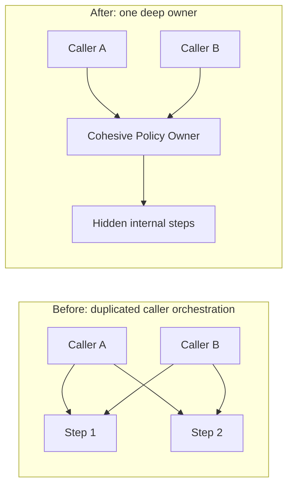
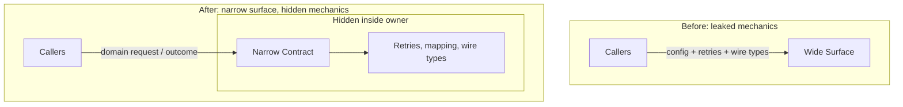
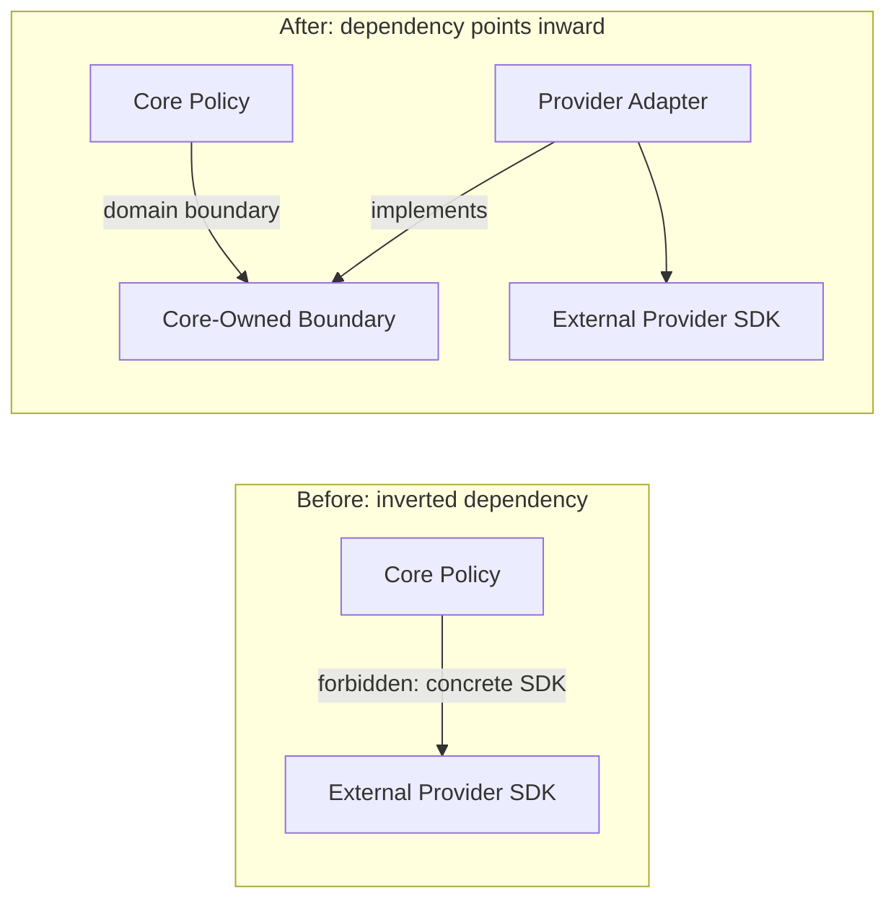
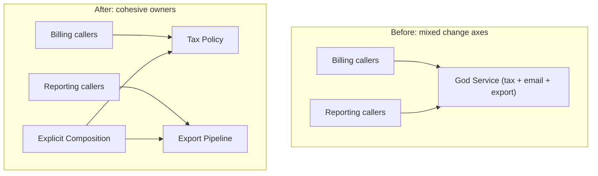
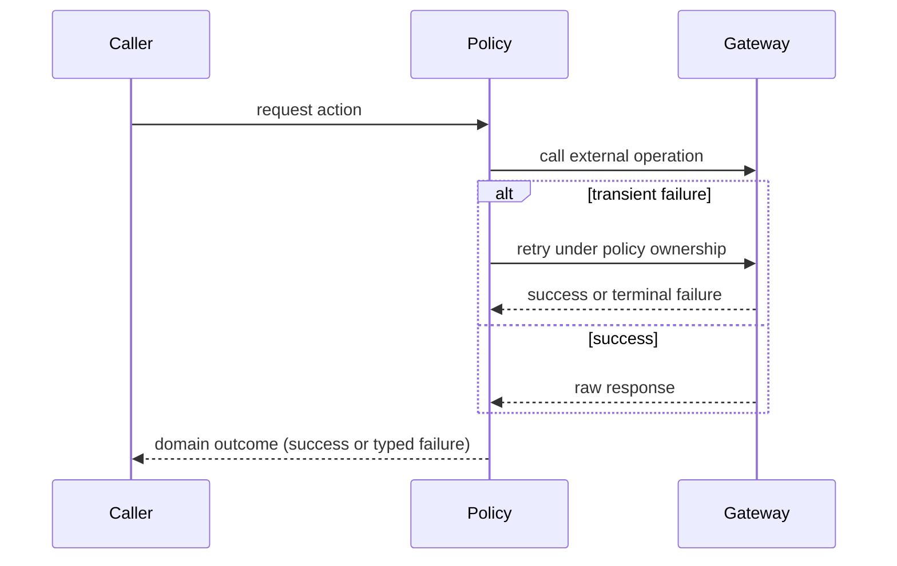
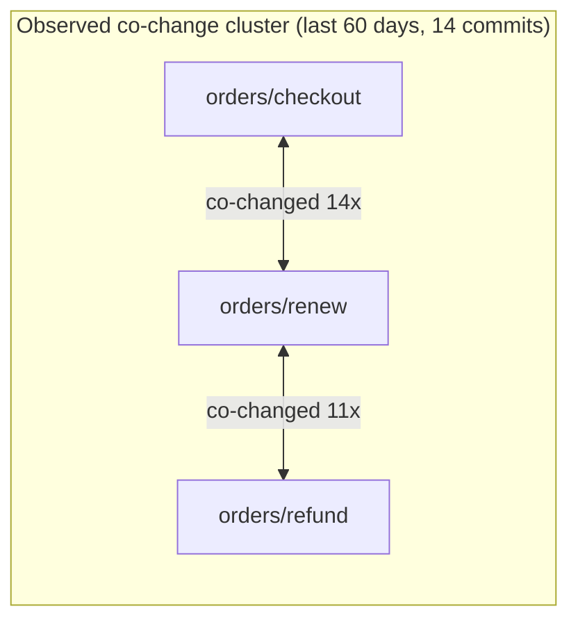

# Architecture Audit Report Template

Use this structure for the default inline Markdown and Mermaid audit report. Write a durable file only when the user asks for one.

## Report Structure

Use this exact section order:

```markdown
# Architecture Audit — <Repository or Fixed Scope>

- **Scope:** <exact directory, package, subsystem or repo>
- **Revision / Worktree:** <commit SHA or branch; note dirty state if observed>
- **Mode:** Read-only audit (no files modified)

## Top Recommendation

**<Candidate title>** — <one-sentence reason why it wins now> (Strength: `Strong` | Confidence: `High`).

<!-- Or, if no candidate rises above Speculative: -->
**No architecture investment now** — <one-sentence evidence summary>. Revisit if <concrete trigger or change pressure>.

## Evidence Summary and Limits

- **Inspected:** <manifests, ADRs, entry points, git history window, test suites>
- **Evidence level:** <static inspection, git history, test run results if already supplied>
- **Limits and open questions:** <uninspected areas, missing runtime metrics, shallow history>

## Ranked Candidates

### 1. <Candidate Title Naming the Structural Move>

- **Strength:** `Strong` | `Worth exploring` | `Speculative`
- **Confidence:** `High` | `Medium` | `Low`
- **Move type:** `Deepen` | `Collapse pass-throughs` | `Split incoherence` | `Move a seam` | `Repair dependency direction` | `Restore locality` | `Make a contract honest`
- **Files and evidence:**
  - `path/to/file:line` — [Fact] <observed import, call path, invariant or test friction>
  - History (<window>) — [Fact] <co-change count or defect history>
- **Current friction (why now):** <concrete cost today and why acting now pays off>
- **Counterevidence (strongest reason not to proceed):** <independent change axes, thin-edge role, compatibility lock-in or missing evidence>
- **Proposed responsibility shift (plain language, no exact signatures):** <what moves where and what callers stop knowing>
- **Before and after:**

  ```mermaid
  <valid before/after Mermaid diagram>
  ```

  *Caption:* <one standalone plain-text sentence stating the structural claim>

- **Expected gains:**
  - *Locality:* <what moves to one owner>
  - *Caller leverage:* <what callers stop coordinating>
  - *Dependency direction:* <which forbidden arrow disappears>
  - *Testability:* <what becomes testable without internal setup>
- **Risks, constraints and ADR conflicts:** <compatibility, fidelity gaps, ownership, migration cost or ADR tensions>
- **Bounded next step and handover:** <single bounded action> -> `<owning-skill>` (plus companions if needed)

## Candidate Comparison

| Candidate | Move type | Strength | Confidence | Why now | Locality & leverage | Migration risk | Next skill |
| --- | --- | --- | --- | --- | --- | --- | --- |
| 1. ... | ... | ... | ... | ... | ... | ... | ... |

## Next Step

Select a candidate above to proceed, or confirm **no architecture investment now**. No interfaces or code edits have been drafted yet.
```

## Mermaid Validity Rules

Follow `mermaid-generator` rules on every diagram:

- Use only supported diagram types (`flowchart LR`, `flowchart TB`, `sequenceDiagram`).
- Use stable alphanumeric node IDs (`callerA`, `corePolicy`) and quote every label containing spaces, parentheses, colons or punctuation (`nodeId["Label (detail)"]`).
- Separate observed relationships from inferred or unresolved ones using dashed arrows (`A -. "inferred" .-> B`). Never draw guesses as solid facts.
- Flag circular dependencies and forbidden imports explicitly in edge labels (`Core -- "forbidden: imports SDK" --> ProviderSDK`).
- Include material error, retry or compensation branches in sequence diagrams with `alt`/`else` when omitting them hides the architectural friction.
- Pair every diagram with a plain-text *Caption* that stands alone without visuals.

## Architectural Diagram Patterns

Pick the smallest pattern that proves the candidate's claim.

### 1. Call-graph collapse

Use when multiple callers duplicate the same sequence.



### 2. Interface-burden cross-section

Use when callers must understand configuration, ordering, provider types or recovery rules.



### 3. Dependency direction

Use when core policy imports a concrete provider, UI framework, route or hardware SDK.



### 4. Responsibility split

Use for a god module with diverging change axes or owners.



### 5. Sequence comparison

Use for repeated round trips, scattered retries, transaction boundaries or lifecycle friction. Show failure paths, not just the happy path.



### 6. Co-change map

Use when commit history exposes scattered ownership. Always state the history window and never infer semantic ownership from churn alone.



## Report Quality Check

Before returning the report, verify:

- Every candidate lists all ten mandatory fields, including counterevidence and next-skill handover.
- No numeric scores appear anywhere in the report.
- Recommendation strength and confidence appear separately as text.
- Every Mermaid block uses quoted labels where needed, valid syntax and a plain-text caption.
- No exact replacement interface signatures or code edits appear in the report.
