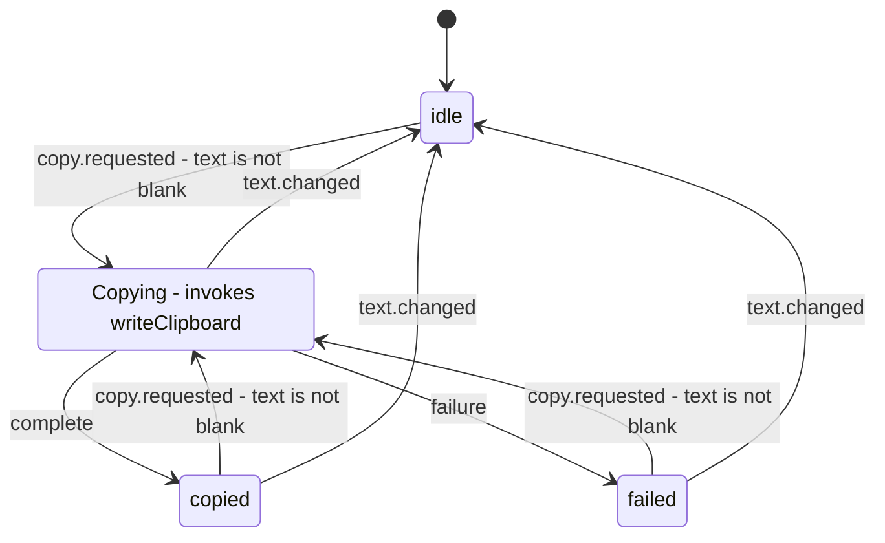

# Composition and component boundaries

Read this guide before you change component variants, compound parts, providers, render props or refs. The examples use browser React 19, not React Native.

## Compose explicit variants instead of mode booleans

Do not add boolean props such as `isEditing`, `isThread` or `showBilling` to change a component's behaviour or assembled structure. Create an explicitly named variant component for each case. Each variant composes the shared parts it needs and states its own provider, visible parts and available actions; a monolithic parent does not decide them. An ordinary fact such as a native button's `disabled` is not a variant switch.

- A shared **presentational** part takes props: it renders the supplied data and imports no feature hook.
- The parts of a **stateful compound widget** read their root's context. Do not add context to a static card only because it has several parts.
- Flat named exports and a namespace such as `Card.Title` are both allowed.

Give each part one responsibility. Keep the existing design system's spacing and typography, merge the caller's `className`, and keep native attributes and refs. Choose semantic HTML for the role, such as `section`, a heading and a paragraph. In React 19, accept `ref` as a normal prop; do not add `forwardRef` or a wrapper `displayName`.

**Good example — `composition-presentational-variants`.** Both variants reuse one set of prop-driven parts that accept native props and typed refs. Class names use the existing app card styles, not a new styling dependency.

```tsx
// example: composition-presentational-variants
import { useRef, type ComponentPropsWithRef } from 'react';

type Member = Readonly<{ id: string; name: string; email: string }>;

export function Card({ className = '', ...props }: ComponentPropsWithRef<'section'>) {
  return <section className={`card ${className}`.trim()} {...props} />;
}

export function CardHeader({ className = '', ...props }: ComponentPropsWithRef<'header'>) {
  return <header className={`card-header ${className}`.trim()} {...props} />;
}

export function CardTitle({ className = '', ...props }: ComponentPropsWithRef<'h2'>) {
  return <h2 className={`card-title ${className}`.trim()} {...props} />;
}

export function CardDescription({ className = '', ...props }: ComponentPropsWithRef<'p'>) {
  return <p className={`card-description ${className}`.trim()} {...props} />;
}

export function CardContent({ className = '', ...props }: ComponentPropsWithRef<'div'>) {
  return <div className={`card-content ${className}`.trim()} {...props} />;
}

export function CardFooter({ className = '', ...props }: ComponentPropsWithRef<'footer'>) {
  return <footer className={`card-footer ${className}`.trim()} {...props} />;
}

export function MemberIdentity({ member }: { member: Member }) {
  return <p><strong>{member.name}</strong> <a href={`mailto:${member.email}`}>{member.email}</a></p>;
}

export function MemberCard({ member }: { member: Member }) {
  return (
    <Card aria-label="Team member">
      <CardHeader><CardTitle>Member</CardTitle></CardHeader>
      <CardContent><MemberIdentity member={member} /></CardContent>
      <CardFooter><a href={`/members/${encodeURIComponent(member.id)}`}>View profile</a></CardFooter>
    </Card>
  );
}

export function SeatCard({ member, plan }: { member: Member; plan: string }) {
  const detailsRef = useRef<HTMLDivElement>(null);
  return (
    <Card aria-label="Assigned seat">
      <CardHeader>
        <CardTitle>Seat holder</CardTitle>
        <CardDescription>{plan} subscription</CardDescription>
      </CardHeader>
      <CardContent ref={detailsRef} tabIndex={-1}>
        <MemberIdentity member={member} />
        <p>This person occupies one paid seat.</p>
      </CardContent>
      <CardFooter>
        <button type="button" onClick={() => detailsRef.current?.focus()}>Focus seat details</button>
      </CardFooter>
    </Card>
  );
}
```

## Use children for structure and render props for supplied data

Compose static headers, footers and actions with `children`, not with a growing list of content props or `renderHeader`/`renderFooter` callbacks. Use a render prop only when its owner supplies data or state to the child, such as an item and its index.

**Good example — `composition-children-and-data`.** The section takes static children. The list's render prop receives list-owned data; the UI unit stays a module-level component, not a nested render function.

```tsx
// example: composition-children-and-data
import { type ReactNode } from 'react';

type Member = Readonly<{ id: string; name: string }>;

export function MemberSection({ children }: { children: ReactNode }) {
  return <section aria-label="Team members">{children}</section>;
}

export function DataList<T extends { readonly id: string }>({
  items,
  renderItem,
}: {
  items: readonly T[];
  renderItem: (data: { item: T; index: number }) => ReactNode;
}) {
  return <ol>{items.map((item, index) => <li key={item.id}>{renderItem({ item, index })}</li>)}</ol>;
}

export function MemberRow({ member, position }: { member: Member; position: number }) {
  return <a href={`/members/${encodeURIComponent(member.id)}`}>{position}. {member.name}</a>;
}

export function MemberDirectory({ members }: { members: readonly Member[] }) {
  return (
    <MemberSection>
      <header><h2>Members</h2><p>{members.length} people in this team</p></header>
      <DataList items={members} renderItem={({ item, index }) => <MemberRow member={item} position={index + 1} />} />
      <footer><a href="/members/invite">Invite a member</a></footer>
    </MemberSection>
  );
}
```

## Colocate units without nesting component definitions

Keep components, hooks, functions, styles and state close to their consumers. For example, keep `note-editor.tsx`, its component-only hook and `note-editor.css` together in the owning feature's `components/`. Move a component that several features need to `src/components/`. Test authoring is not a reason to scatter implementation.

Extract each recognisable UI unit into a module-level component. Never define a component inside another component to capture its variables; pass those values as props. A component type defined during render is new on every parent render, so React remounts it: it loses local state, focus, scroll position and DOM, restarts animations, and runs Effect cleanup and setup again. An inline event callback, or a data render prop that returns an existing component, is not a nested component definition.

**Good example — `composition-stable-ui-units`.** Typing the heading re-renders the parent without replacing the editor's component type. The editor receives the heading as a prop and keeps its own draft.

```tsx
// example: composition-stable-ui-units
import { useId, useState } from 'react';

export function NoteEditor({ heading }: { heading: string }) {
  const id = useId();
  const [draft, setDraft] = useState('');
  return (
    <section aria-labelledby={`${id}-title`}>
      <h2 id={`${id}-title`}>{heading || 'Untitled note'}</h2>
      <label htmlFor={`${id}-body`}>Note body</label>
      <textarea id={`${id}-body`} value={draft} onChange={(event) => setDraft(event.currentTarget.value)} />
      <p>{draft.length} characters</p>
    </section>
  );
}

export function NoteWorkspace() {
  const [heading, setHeading] = useState('Meeting notes');
  return (
    <main>
      <label>Heading <input value={heading} onChange={(event) => setHeading(event.currentTarget.value)} /></label>
      <NoteEditor heading={heading} />
    </main>
  );
}
```

## Inject an interchangeable state, actions and meta contract

Only the provider knows how the widget stores its state. Parts consume their root's typed contract of `state`, named `actions` (including any submit or publish action) and `meta`; they do not call a storage hook or a feature-state hook. You can swap providers without changing parts. Expose intent such as `changeText`, `commit` and `reset`, not a generic `update(updater)`, storage objects or unrestricted setters.

Lift state only as far as its consumers need. Wrap all sibling consumers in the provider, including a preview or action outside the visual frame. Never copy child state upward with an Effect that calls a change callback. Never read sibling state through a ref at submit time. A `meta` ref may hold a DOM handle for focus; it is not a second state channel.

A draft, or a synchronous local commit that one event completes, can use `useState` or `useReducer`; sharing it does not make it a machine. Leave context-value memoisation to React Compiler; do not add blanket `useMemo` or `useCallback`. An asynchronous save is different: its external answer and interruptible middle need the actor adaptation in the next section, not extra React flags.

**Good example — `composition-interchangeable-providers`.** Both providers implement one interface. The new-note provider uses local state; the edit provider uses a synchronous reducer with atomic commit and reset actions. The shared input, preview and actions know neither implementation. "Keep locally" updates the displayed kept version; it does not pretend to save to a server. State lasts while the provider is mounted; a new note identity remounts the edit provider by `key`.

```tsx
// example: composition-interchangeable-providers
import {
  createContext, useContext, useId, useReducer, useRef, useState,
  type ReactNode, type RefObject,
} from 'react';

type DraftState = Readonly<{ text: string; keptText: string }>;
interface DraftActions {
  changeText: (text: string) => void;
  commit: () => void;
  reset: () => void;
}
type DraftMeta = Readonly<{
  inputRef: RefObject<HTMLTextAreaElement | null>;
  label: string;
}>;
interface DraftContract {
  state: DraftState;
  actions: DraftActions;
  meta: DraftMeta;
}
const DraftContext = createContext<DraftContract | null>(null);

function useDraft() {
  const value = useContext(DraftContext);
  if (value === null) throw new Error('Draft parts need a draft provider');
  return value;
}

export function NewNoteProvider({ children }: { children: ReactNode }) {
  const [text, setText] = useState('');
  const [keptText, setKeptText] = useState('');
  const inputRef = useRef<HTMLTextAreaElement>(null);
  const value: DraftContract = {
    state: { text, keptText },
    actions: {
      changeText: setText,
      commit: () => setKeptText(text),
      reset: () => setText(keptText),
    },
    meta: { inputRef, label: 'New note' },
  };
  return <DraftContext value={value}>{children}</DraftContext>;
}

type DraftEvent =
  | { type: 'text.changed'; text: string }
  | { type: 'draft.committed' }
  | { type: 'draft.reset' };

function draftReducer(state: DraftState, event: DraftEvent): DraftState {
  switch (event.type) {
    case 'text.changed': return { ...state, text: event.text };
    case 'draft.committed': return { ...state, keptText: state.text };
    case 'draft.reset': return { ...state, text: state.keptText };
  }
}

export function EditNoteProvider({ initialText, children }: { initialText: string; children: ReactNode }) {
  const [state, dispatch] = useReducer(draftReducer, { text: initialText, keptText: initialText });
  const inputRef = useRef<HTMLTextAreaElement>(null);
  const value: DraftContract = {
    state,
    actions: {
      changeText: (text) => dispatch({ type: 'text.changed', text }),
      commit: () => dispatch({ type: 'draft.committed' }),
      reset: () => dispatch({ type: 'draft.reset' }),
    },
    meta: { inputRef, label: 'Edit note' },
  };
  return <DraftContext value={value}>{children}</DraftContext>;
}

export function DraftFrame({ children }: { children: ReactNode }) {
  return <section aria-label="Draft editor">{children}</section>;
}

export function DraftInput() {
  const { state, actions, meta } = useDraft();
  const id = useId();
  return (
    <div>
      <label htmlFor={id}>{meta.label}</label>
      <textarea id={id} ref={meta.inputRef} value={state.text} onChange={(event) => actions.changeText(event.currentTarget.value)} />
    </div>
  );
}

export function DraftPreview() {
  const { state } = useDraft();
  return (
    <aside aria-label="Note preview">
      <p>Draft: {state.text || '(empty)'}</p>
      <p>Kept locally: {state.keptText || '(empty)'}</p>
    </aside>
  );
}

export function KeepDraft() {
  const { state, actions } = useDraft();
  return <button type="button" disabled={state.text === state.keptText} onClick={actions.commit}>Keep locally</button>;
}

export function ResetDraft() {
  const { state, actions, meta } = useDraft();
  return (
    <button type="button" disabled={state.text === state.keptText} onClick={() => {
      actions.reset();
      meta.inputRef.current?.focus();
    }}>Discard changes</button>
  );
}

export function NewNoteComposer() {
  return (
    <NewNoteProvider>
      <DraftFrame><DraftInput /><KeepDraft /></DraftFrame>
      <DraftPreview />
    </NewNoteProvider>
  );
}

export function EditNoteComposer({ note }: { note: Readonly<{ id: string; text: string }> }) {
  return (
    <EditNoteProvider key={note.id} initialText={note.text}>
      <DraftFrame><DraftInput /></DraftFrame>
      <DraftPreview />
      <footer><ResetDraft /><KeepDraft /></footer>
    </EditNoteProvider>
  );
}
```

## Adapt temporal compound state to an actor provider

For state that waits for an external answer or has an interruptible middle, follow `web:xstate`. When XState is installed, provide shared machine state with `createActorContext`:

- The provider supplies the actor reference.
- Parts use focused `ActorContext.useSelector()` subscriptions and send named, typed events.
- Do not rebuild a second state and actions object from a whole snapshot, copy the snapshot into React state, or expose generic updater events.
- Do not call `use(ActorContext)` or `useContext(ActorContext)`: an actor context is not a React context object.
- Keep the machine implementation and its effects outside the UI parts.

**Good example — `composition-actor-compound`.** Prerequisites: `xstate` 5 and `@xstate/react` 6 installed, and browser clipboard support in a secure context. Copying waits for the real clipboard promise; a failure is visible and the user can retry. Editing during copying exits the invocation, so a late answer cannot claim that new text was copied. The clipboard API cannot abort an issued OS write, and ignoring an obsolete result does not undo it. The status sibling is outside the editor frame but inside the same provider.

```tsx
// example: composition-actor-compound
import { useId, type ReactNode } from 'react';
import { assign, fromPromise, setup } from 'xstate';
import { createActorContext } from '@xstate/react';

type CopyContext = { text: string; error: string | null };
type CopyEvent = { type: 'text.changed'; text: string } | { type: 'copy.requested' };

const writeClipboard = fromPromise<void, { text: string }>(async ({ input }) => {
  if (!navigator.clipboard) throw new Error('Clipboard access is unavailable');
  await navigator.clipboard.writeText(input.text);
});

const copyMachine = setup({
  types: {
    context: {} as CopyContext,
    events: {} as CopyEvent,
    input: {} as { initialText: string },
  },
  actors: { writeClipboard },
  guards: {
    hasText: ({ context }) => context.text.trim().length > 0,
  },
}).createMachine({
  id: 'copyDraft',
  initial: 'idle',
  context: ({ input }) => ({ text: input.initialText, error: null }),
  on: {
    'text.changed': {
      target: '.idle',
      actions: assign({ text: ({ event }) => event.text, error: null }),
    },
  },
  states: {
    idle: { on: { 'copy.requested': { target: 'copying', guard: 'hasText' } } },
    copying: {
      entry: assign({ error: null }),
      invoke: {
        src: 'writeClipboard',
        input: ({ context }) => ({ text: context.text }),
        onDone: 'copied',
        onError: {
          target: 'failed',
          actions: assign({ error: ({ event }) => event.error instanceof Error ? event.error.message : 'Clipboard write failed' }),
        },
      },
    },
    copied: { on: { 'copy.requested': { target: 'copying', guard: 'hasText' } } },
    failed: { on: { 'copy.requested': { target: 'copying', guard: 'hasText' } } },
  },
});

const CopyActor = createActorContext(copyMachine);

export function CopyProvider({ initialText, children }: { initialText: string; children: ReactNode }) {
  return <CopyActor.Provider options={{ input: { initialText } }}>{children}</CopyActor.Provider>;
}

export function CopyInput() {
  const id = useId();
  const text = CopyActor.useSelector((snapshot) => snapshot.context.text);
  const actor = CopyActor.useActorRef();
  return (
    <div>
      <label htmlFor={id}>Text to copy</label>
      <textarea id={id} value={text} onChange={(event) => actor.send({ type: 'text.changed', text: event.currentTarget.value })} />
    </div>
  );
}

export function CopyButton() {
  const canCopy = CopyActor.useSelector((snapshot) => snapshot.can({ type: 'copy.requested' }));
  const actor = CopyActor.useActorRef();
  return <button type="button" disabled={!canCopy} onClick={() => actor.send({ type: 'copy.requested' })}>Copy text</button>;
}

export function CopyStatus() {
  const status = CopyActor.useSelector((snapshot) => snapshot.value);
  const error = CopyActor.useSelector((snapshot) => snapshot.context.error);
  return (
    <p role="status">
      {status === 'copying' ? 'Copying…' : status === 'copied' ? 'Copied to clipboard' : error ?? 'Ready to copy'}
    </p>
  );
}

export function CopyComposer({ initialText }: { initialText: string }) {
  return (
    <CopyProvider initialText={initialText}>
      <section aria-label="Copy editor"><CopyInput /><CopyButton /></section>
      <CopyStatus />
    </CopyProvider>
  );
}
```

The mounted provider owns the actor's lifetime. `initialText` is initial input, not a prop that stays synchronised; remount by document identity when the owner changes. The diagram describes `copyMachine` above; `copying` invokes the clipboard promise, not a second machine.



The diagram omits `text.changed` in `idle`: there it updates the text and clears the error, and no invocation needs to stop.

## Read context with useContext, and with use only when the read is conditional

React 19 has both `useContext` and `use`. Use `useContext` for an unconditional context read. Use `use` when the read must be conditional. Do not rewrite normal reads only to change the API name. Neither API reads an XState actor context.

**Good example — `composition-conditional-context`.** The member branch needs team context; an anonymous credit can render outside the provider. The team heading reads its context unconditionally with `useContext`.

```tsx
// example: composition-conditional-context
import { createContext, use, useContext, type ReactNode } from 'react';

type Team = Readonly<{ name: string }>;
type Author = { kind: 'anonymous' } | { kind: 'member'; name: string };
const TeamContext = createContext<Team | null>(null);

export function TeamProvider({ team, children }: { team: Team; children: ReactNode }) {
  return <TeamContext value={team}>{children}</TeamContext>;
}

export function TeamHeading() {
  const team = useContext(TeamContext);
  if (team === null) throw new Error('TeamHeading needs TeamProvider');
  return <h2>{team.name}</h2>;
}

export function AuthorCredit({ author }: { author: Author }) {
  if (author.kind === 'anonymous') return <p>By an anonymous contributor</p>;
  const team = use(TeamContext);
  if (team === null) throw new Error('Member credits need TeamProvider');
  return <p>By {author.name} from {team.name}</p>;
}

export function ArticleCredits() {
  return (
    <section aria-label="Article contributors">
      <AuthorCredit author={{ kind: 'anonymous' }} />
      <TeamProvider team={{ name: 'Field research' }}>
        <TeamHeading />
        <AuthorCredit author={{ kind: 'member', name: 'Asha' }} />
      </TeamProvider>
    </section>
  );
}
```

## Wrap third-party components behind the app contract

Put a shared third-party UI adapter in `src/components/ui/`. Expose app-owned props and translate the dependency's names and behaviour in that one file, so a dependency change does not spread through features. Wrap a library that is already installed; do not copy an upstream placeholder package or install a dependency only to wrap it.

**Good example — `composition-third-party-wrapper`.** Prerequisite: React Router 7 installed, with `NavLink` exported from `react-router`. This module belongs at `src/components/ui/navigation-link.tsx` and renders under the app's existing router. Features pass `destination` and `label`; only the adapter knows `NavLink`'s `to`, `end`, active-state callback and automatic `aria-current` behaviour.

```tsx
// example: composition-third-party-wrapper
import { type Ref } from 'react';
import { NavLink } from 'react-router';

type NavigationLinkProps = Readonly<{
  destination: string;
  label: string;
  className?: string;
  ref?: Ref<HTMLAnchorElement>;
}>;

export function NavigationLink({ destination, label, className = '', ref }: NavigationLinkProps) {
  return (
    <NavLink
      ref={ref}
      to={destination}
      end
      className={({ isActive }) => `navigation-link ${isActive ? 'navigation-link-active' : ''} ${className}`.trim()}
    >
      {label}
    </NavLink>
  );
}

export function SettingsNavigation() {
  return (
    <nav aria-label="Team settings">
      <NavigationLink destination="/settings/members" label="Members" />
      <NavigationLink destination="/settings/billing" label="Billing" />
    </nav>
  );
}
```
