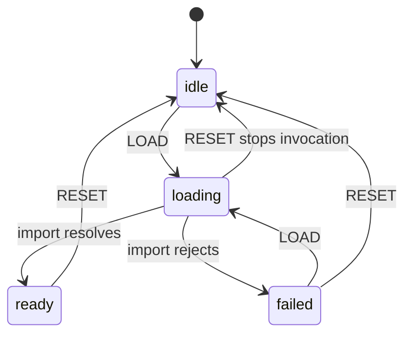
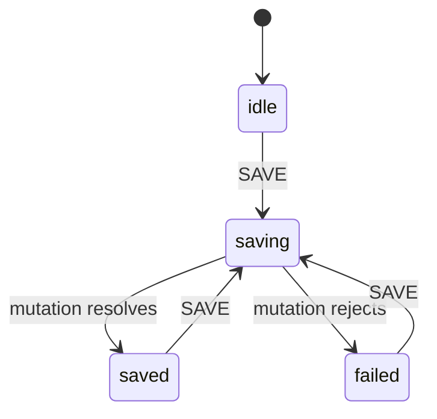

# React performance and rendering correctness

These rules apply to client-only React 19 applications. Fix the measured bottleneck, not every render. A render is not evidence of a performance defect. Before you add `memo`, `useMemo`, `useCallback` or manually hoisted JSX, check whether React Compiler is enabled:

- Compiler enabled: leave memoisation to the compiler.
- Compiler disabled: add manual memoisation only for measured expensive work.

## Measure the interaction before changing it

Record a repeatable interaction, a representative data size, the build mode, the device and the compiler setting. For example: type the same search term into a 5,000-member directory and compare the input response and the results commit before and after the change. Use the React DevTools Profiler to find the responsible subtree. Inspect the network waterfall for route or resource loading. Repeat the same interaction in the same environment after the change. Record observations, not a promised percentage or an impact label. The examples below show mechanisms; none of them proves a speed result for your application.

When several measured problems compete, fix route and feature loading and duplicate client work before small render optimisations. Leave advanced patterns until their need is established. Server rendering and plain-JavaScript optimisation rules are outside this skill's scope.

**Good measurement example — `react-performance-profile-boundary`.** Profile the suspected results subtree, not unrelated UI. The callback records real observations, not invented timings. Measure production behaviour with a profiling-enabled build; development Strict Mode work is not a production timing baseline.

```tsx
// example: react-performance-profile-boundary
import { Profiler, type ProfilerOnRenderCallback, type ReactNode } from 'react';

const recordRender: ProfilerOnRenderCallback = (
  id, phase, actualDuration, baseDuration, startTime, commitTime,
) => {
  console.info(JSON.stringify({
    id, phase, actualDuration, baseDuration, startTime, commitTime,
  }));
};

export function ProfiledResults({ children }: { children: ReactNode }) {
  return <Profiler id="member-results" onRender={recordRender}>{children}</Profiler>;
}
```

## Keep rendering pure

Do not mutate props, state or externally visible objects that existed before this render. React can run a render again or abandon it. Build a new local result instead. Mutating a fresh local accumulator is safe while it cannot escape before the computation returns. Keep externally visible changes in the event handler or the lifecycle owner, not in render.

React render purity is separate from domain purity. A business rule should also work without React, but extracting it does not make an impure render safe.

**Good example — `react-performance-pure-render`.** Sorting returns a new array, and the local histogram owns every write. When React renders again, neither the supplied seats nor a module-level report is mutated.

```tsx
// example: react-performance-pure-render
type Seat = { id: string; name: string; team: string };

export function SeatSummary({ seats }: { seats: readonly Seat[] }) {
  const sorted = seats.slice().sort((left, right) => left.name.localeCompare(right.name));
  const totals = new Map<string, number>();
  for (const seat of seats) totals.set(seat.team, (totals.get(seat.team) ?? 0) + 1);
  return (
    <section>
      <ul>{sorted.map(seat => <li key={seat.id}>{seat.name}</li>)}</ul>
      <dl>{Array.from(totals, ([team, count]) => <div key={team}><dt>{team}</dt><dd>{count}</dd></div>)}</dl>
    </section>
  );
}
```

An existing module-level cache used during render is permitted only for a **pure function keyed by all its inputs**, and only when a measured cost justifies it. A cache hit and a cache miss must have the same observable result. Do not cache mutable session or cookie state, omit inputs from keys or expose mutable cached values. This restricts an existing measured cache; it does not recommend adding one. The pure local calculation above is the correct default.

## Split routes with React.lazy and Suspense

Load route code on demand with `lazy` and show a meaningful `Suspense` fallback.

- Define lazy components outside rendering, so their identity does not change on every render.
- Import the route file itself, not a feature barrel.
- Use the existing router; do not add a second router.
- A rejected lazy import goes to an error boundary, not to a permanent loading message.

**Good example — `react-performance-lazy-routes`.** The next two modules are real import targets; save each under its example ID with a `.tsx` extension. These small pages show the loading boundary; their size does not prove that splitting is needed.

```tsx
// example: performance-reports-panel
import { useState } from 'react';

const reportNames = ['Seat usage', 'Invoices', 'Member activity'];

export default function ReportsPanel() {
  const [query, setQuery] = useState('');
  const lowerQuery = query.toLowerCase();
  const matches = reportNames.filter(name => name.toLowerCase().includes(lowerQuery));
  return (
    <section>
      <h1>Reports</h1>
      <label>Find a report <input value={query} onChange={event => setQuery(event.currentTarget.value)} /></label>
      <ul>{matches.map(name => <li key={name}>{name}</li>)}</ul>
    </section>
  );
}
```

```tsx
// example: performance-note-editor
import { useState } from 'react';

export type NoteEditorProps = { initialText?: string };

export default function NoteEditor({ initialText = '' }: NoteEditorProps) {
  const [text, setText] = useState(initialText);
  return (
    <section>
      <h1>Notes</h1>
      <label>Draft <textarea value={text} onChange={event => setText(event.currentTarget.value)} /></label>
      <output>{text.length} characters</output>
    </section>
  );
}
```

```tsx
// example: react-performance-lazy-routes
import { Component, lazy, Suspense, type ReactNode } from 'react';
import { Link, Route, Routes } from 'react-router';

const Reports = lazy(() => import('./performance-reports-panel'));
const Notes = lazy(() => import('./performance-note-editor'));

class RouteLoadBoundary extends Component<{ children: ReactNode }, { error: string | null }> {
  override state: { error: string | null } = { error: null };

  static getDerivedStateFromError(error: unknown): { error: string } {
    return { error: error instanceof Error ? error.message : String(error) };
  }

  override render() {
    if (this.state.error !== null) {
      return <p role="alert">This page could not load: {this.state.error}. Reload the page to try again.</p>;
    }
    return this.props.children;
  }
}

export function ApplicationRoutes() {
  return (
    <RouteLoadBoundary>
      <nav><Link to="/reports">Reports</Link> <Link to="/notes">Notes</Link></nav>
      <Suspense fallback={<p role="status">Loading page…</p>}>
        <Routes>
          <Route path="/reports" element={<Reports />} />
          <Route path="/notes" element={<Notes />} />
          <Route path="*" element={<p>Choose a page.</p>} />
        </Routes>
      </Suspense>
    </RouteLoadBoundary>
  );
}
```

Mount `ApplicationRoutes` inside the application's existing React Router provider. The editor's `initialText` is creation-time data, not a copy kept in step with future props.

## Load conditional modules and preload on intent

Keep a conditional feature's module out of the eager import path. Load it only when it is activated, or preload it on hover, keyboard focus or an enabling feature flag. Preloading is speculative: measure its network cost as well as the wait it removes. In this client-only scope, no server-bundle claim or `typeof window` guard is needed.

An import that finishes after the feature is disabled, replaced or unmounted must not restore an obsolete feature or report an obsolete failure. `import()` cannot be aborted. When XState is installed, let an invoked actor own the loading attempt: stopping the actor discards its outcome, not the module download. If neither an actor nor an installed data library is available and dependencies are frozen, an async Effect needs the stale-run guard on **both** success and failure described in [state-effects.md](state-effects.md#use-the-async-effect-fallback-only-with-frozen-dependencies).

**Good example — `react-performance-conditional-preload`.** It uses the real `performance-note-editor` module above. `IntentLoadedEditor` loads on hover, focus or click. `FlagLoadedEditor` loads when its flag becomes true and resets when the flag becomes false. The view reads the actor's status, not another React loading flag. The open toggle is synchronous UI state that only the user controls.

```tsx
// example: react-performance-conditional-preload
import { useEffect, useState, type ComponentType } from 'react';
import { useActorRef, useSelector } from '@xstate/react';
import { assign, fromPromise, setup, type ActorRefFrom } from 'xstate';
import type { NoteEditorProps } from './performance-note-editor';

const loadEditor = fromPromise(async () => import('./performance-note-editor'));
type ModuleContext = {
  Editor: ComponentType<NoteEditorProps> | null;
  error: string | null;
};
type ModuleEvent = { type: 'LOAD' } | { type: 'RESET' };

const editorModuleMachine = setup({
  types: {
    context: {} as ModuleContext,
    events: {} as ModuleEvent,
  },
  actors: { loadEditor },
}).createMachine({
  context: { Editor: null, error: null },
  initial: 'idle',
  on: {
    RESET: { target: '.idle', actions: assign({ Editor: null, error: null }) },
  },
  states: {
    idle: { on: { LOAD: 'loading' } },
    loading: {
      entry: assign({ error: null }),
      invoke: {
        src: 'loadEditor',
        onDone: {
          target: 'ready',
          actions: assign(({ event }) => ({ Editor: event.output.default })),
        },
        onError: {
          target: 'failed',
          actions: assign({ error: ({ event }) => event.error instanceof Error ? event.error.message : String(event.error) }),
        },
      },
    },
    ready: {},
    failed: { on: { LOAD: 'loading' } },
  },
});

type ModuleActor = ActorRefFrom<typeof editorModuleMachine>;

function EditorContents({ actor }: { actor: ModuleActor }) {
  const Editor = useSelector(actor, snapshot => snapshot.context.Editor);
  const error = useSelector(actor, snapshot => snapshot.context.error);
  if (error !== null) {
    return (
      <div role="alert">
        <p>Editor could not load: {error}</p>
        <button onClick={() => actor.send({ type: 'LOAD' })}>Try loading again</button>
      </div>
    );
  }
  return Editor === null ? <p role="status">Preparing editor…</p> : <Editor />;
}

export function IntentLoadedEditor() {
  const actor = useActorRef(editorModuleMachine);
  const [isOpen, setIsOpen] = useState(false);
  const preload = () => actor.send({ type: 'LOAD' });
  return (
    <>
      <button
        onMouseEnter={preload}
        onFocus={preload}
        onClick={() => { setIsOpen(true); actor.send({ type: 'LOAD' }); }}
      >Open editor</button>
      {isOpen && <EditorContents actor={actor} />}
      {isOpen && <button onClick={() => setIsOpen(false)}>Close editor</button>}
    </>
  );
}

export function FlagLoadedEditor({ enabled }: { enabled: boolean }) {
  const actor = useActorRef(editorModuleMachine);
  useEffect(() => {
    actor.send({ type: enabled ? 'LOAD' : 'RESET' });
    return () => { actor.send({ type: 'RESET' }); };
  }, [actor, enabled]);
  return enabled ? <EditorContents actor={actor} /> : null;
}
```



The Effect applies the **current** `enabled` value on its first run and on every later run, with no previous-value comparison. Unmount stops the actor, so a late import outcome does no harm. `ready` ignores repeated hover and focus loads.

## Narrow subscriptions and move state below unrelated children

Split global state by usage; do not make every reader subscribe to unrelated user, theme, notification and cart updates. A selector-capable store can keep one underlying store if each reader subscribes narrowly. With an actor, use focused `useSelector` subscriptions, not a whole snapshot followed by destructuring. The complete selector example is in [state-effects.md](state-effects.md#subscribe-to-the-smallest-rendered-value).

For an expensive initial value, pass a pure initialiser to `useState`, not the result of running the computation on every render. A cheap literal or direct reference needs no function. This captures an initial value; it does not synchronise a live prop. Development Strict Mode may call the initialiser twice. The complete example is in [state-effects.md](state-effects.md#initialise-expensive-local-state-lazily).

Create an unrelated subtree outside the component that owns frequently changing state, then pass it as `children`. The owning component then does not recreate the child element on its own updates. This does **not** stop the child's own state, context, actor or parent-supplied prop changes from rendering it.

**Good example — `react-performance-stable-children`.** Only the counter owns its changing count. The outer component creates the report, not the counter's render. This shows structural ownership; it does not show that the small report is expensive.

```tsx
// example: react-performance-stable-children
import { useState, type ReactNode } from 'react';

type Seat = { id: string; name: string };

function Counter({ children }: { children: ReactNode }) {
  const [count, setCount] = useState(0);
  return (
    <section>
      <button onClick={() => setCount(current => current + 1)}>Count: {count}</button>
      {children}
    </section>
  );
}

function SeatReport({ seats }: { seats: readonly Seat[] }) {
  return <ul>{seats.map(seat => <li key={seat.id}>{seat.name}</li>)}</ul>;
}

export function SeatReportWithCounter({ seats }: { seats: readonly Seat[] }) {
  return <Counter><SeatReport seats={seats} /></Counter>;
}
```

## Memoise only measured work without the compiler

**Prerequisite:** the manual memoisation examples require **React Compiler disabled** and profiling that shows these computations or renders are costly on the real dataset. With the compiler enabled, keep component boundaries, early returns and pure computations, and remove manual `memo` and `useMemo` wrappers. The snippets do not prove that their small sample operation needs caching.

Put expensive work in a child that the parent does not render while it returns a loading or empty view. Do not calculate it with a parent hook before the parent's early return. If manual memoisation is justified, a `memo` child can also skip renders caused by the parent when its props are unchanged. That is an optimisation, not a correctness guarantee.

**Good compiler-enabled example — `react-performance-compiler-boundary`.** With React Compiler configured, ordinary pure components keep the early-return boundary without manual memoisation. Keep the placeholder inline, not manually hoisted. Compiler configuration is a prerequisite; this module does not enable it.

```tsx
// example: react-performance-compiler-boundary
type Reading = { id: string; seats: number };

function UsageRows({ readings }: { readings: readonly Reading[] }) {
  return <ul>{readings.map(reading => <li key={reading.id}>{reading.seats} seats</li>)}</ul>;
}

export function CompiledUsagePanel({ readings, loading }: {
  readings: readonly Reading[];
  loading: boolean;
}) {
  if (loading) return <p role="status">Loading usage</p>;
  return <UsageRows readings={readings} />;
}
```

**Good example — `react-performance-measured-memo`.** The histogram work is inside the child, so the parent's loading branch never calls it.

```tsx
// example: react-performance-measured-memo
import { memo, useMemo } from 'react';

type Reading = { day: string; seats: number };

function totalsByDay(readings: readonly Reading[]): readonly [string, number][] {
  const totals = new Map<string, number>();
  for (const reading of readings) {
    totals.set(reading.day, (totals.get(reading.day) ?? 0) + reading.seats);
  }
  return Array.from(totals.entries());
}

const UsageHistogram = memo(function UsageHistogram({ readings }: { readings: readonly Reading[] }) {
  const totals = useMemo(() => totalsByDay(readings), [readings]);
  return <ul>{totals.map(([day, total]) => <li key={day}>{day}: {total} seats</li>)}</ul>;
});

export function UsagePanel({ readings, loading }: { readings: readonly Reading[]; loading: boolean }) {
  if (loading) return <p role="status">Loading usage…</p>;
  return <UsageHistogram readings={readings} />;
}
```

When measured computations depend on different inputs, memoise them separately, so a change to one input does not rerun work that does not use it. A dependent stage depends on the result of its previous stage. Do not split a cheap expression into more hooks. Independent Effects follow the same dependency rule; see [state-effects.md](state-effects.md#declare-real-dependencies-and-split-independent-effects).

**Good example — `react-performance-independent-memos`.** Category filtering does not depend on sort order; sorting depends on the filtered result and the order. This manual form has the same compiler and measurement prerequisite as the previous example.

```tsx
// example: react-performance-independent-memos
import { useMemo } from 'react';

type Product = { id: string; name: string; category: string; price: number };

export function ProductResults({ products, category, order }: {
  products: readonly Product[];
  category: string;
  order: 'ascending' | 'descending';
}) {
  const filtered = useMemo(
    () => products.filter(product => product.category === category),
    [products, category],
  );
  const sorted = useMemo(
    () => filtered.slice().sort((left, right) => order === 'ascending' ? left.price - right.price : right.price - left.price),
    [filtered, order],
  );
  return <ul>{sorted.map(product => <li key={product.id}>{product.name}: {product.price}</li>)}</ul>;
}
```

Do not use `useCallback` as a general way to remove Effect dependencies. First move an Effect-only helper inside the Effect, and keep every reactive dependency. Use an Effect Event only for genuinely non-reactive Effect logic, not as a stable callback prop. Without the compiler, a callback's identity may be worth keeping when profiling shows that it invalidates an expensive memoised child. Keep its real dependencies; a cache does not permit a stale closure. With the compiler, leave this memoisation to the compiler.

**Good example — `react-performance-measured-callback`.** With the compiler off and a measured child cost, the memoised list's callback uses a functional state update, so it does not capture an old selection. It does real work, not a no-op default. A cheap list without that measured cost needs neither manual wrapper.

```tsx
// example: react-performance-measured-callback
import { memo, useCallback, useState } from 'react';

type Member = { id: string; name: string };

const MemberChoices = memo(function MemberChoices({ members, onChoose }: {
  members: readonly Member[];
  onChoose: (id: string) => void;
}) {
  return <ul>{members.map(member => <li key={member.id}>
    <button onClick={() => onChoose(member.id)}>{member.name}</button>
  </li>)}</ul>;
});

export function MemberPicker({ members }: { members: readonly Member[] }) {
  const [selected, setSelected] = useState<readonly string[]>([]);
  const choose = useCallback((id: string) => {
    setSelected(current => current.includes(id) ? current : [...current, id]);
  }, []);
  return (
    <section>
      <MemberChoices members={members} onChoose={choose} />
      <output>{selected.length} selected</output>
    </section>
  );
}
```

Calculate a cheap primitive expression directly, in either compiler mode. A boolean OR, a string concatenation or a small arithmetic expression does not need `useMemo`.

**Good example — `react-performance-cheap-expression`.** Loading is a derived boolean, not a second state variable and not a memoised expression.

```tsx
// example: react-performance-cheap-expression
export function DirectoryHeading({ membersLoading, rolesLoading, count }: {
  membersLoading: boolean;
  rolesLoading: boolean;
  count: number;
}) {
  const loading = membersLoading || rolesLoading;
  return <h1>{loading ? 'Loading directory…' : `Directory (${count})`}</h1>;
}
```

## Hoist static JSX only without the compiler

With React Compiler enabled, leave static JSX in the component. Without it, move genuinely static JSX out of rendering only when its recreation is a measured cost. Do not hoist elements that depend on props, state or context.

**Good example — `react-performance-static-jsx`.** With the compiler off and recreation measured as costly, create the unchanging placeholder once. A real measured static subtree may be larger; this small fragment alone does not prove that hoisting helps.

```tsx
// example: react-performance-static-jsx
import type { ReactNode } from 'react';

const pendingReport = (
  <section aria-label="Report loading">
    <h2>Report</h2>
    <p role="status">Preparing report…</p>
  </section>
);

export function ReportFrame({ loading, children }: { loading: boolean; children: ReactNode }) {
  return loading ? pendingReport : <section>{children}</section>;
}
```

## Keep numeric values off the left of JSX &&

Use an explicit ternary when the condition can be `0` or `NaN`, because React can render those as text. A genuinely boolean condition may use `&&`; do not ban or rewrite it only for consistency.

**Good example — `react-performance-boolean-condition`.** Zero and non-finite counts show no badge, and the boolean banner stays a valid `&&` expression.

```tsx
// example: react-performance-boolean-condition
export function InboxSummary({ count, showHelp }: { count: number; showHelp: boolean }) {
  return (
    <section>
      {Number.isFinite(count) && count > 0 ? <span>{count} unread</span> : null}
      {showHelp && <p>Choose a message to read it.</p>}
    </section>
  );
}
```

## Preserve hidden UI with Activity without promising frozen renders

Use `Activity` (React 19.2 or later) when a frequently hidden subtree must keep its state and DOM. Hidden children **still re-render** for new props at a lower priority. React cleans up their Effects while they are hidden and recreates the Effects when they become visible. Do not use Activity to promise that hidden code stops rendering or that an external subscription keeps running. The external target must receive its current value again when Effects restart.

**Good example — `react-performance-activity-draft`.** Hiding and reopening keeps the draft and the textarea DOM. Hiding cleans up the title Effect; showing applies the current title again, including on first display. The checkbox is a synchronous toggle, not an asynchronous lifecycle.

```tsx
// example: react-performance-activity-draft
import { Activity, useEffect, useState } from 'react';

function DraftEditor({ title }: { title: string }) {
  const [draft, setDraft] = useState('');
  useEffect(() => {
    const previousTitle = document.title;
    document.title = title;
    return () => { document.title = previousTitle; };
  }, [title]);
  return (
    <label>Draft for {title}
      <textarea value={draft} onChange={event => setDraft(event.currentTarget.value)} />
    </label>
  );
}

export function DraftWorkspace({ title }: { title: string }) {
  const [visible, setVisible] = useState(true);
  return (
    <section>
      <label><input type="checkbox" checked={visible} onChange={event => setVisible(event.currentTarget.checked)} />Show editor</label>
      <Activity mode={visible ? 'visible' : 'hidden'}><DraftEditor title={title} /></Activity>
    </section>
  );
}
```

## Use transitions for render scheduling, not request ownership

Use `startTransition` for non-urgent state updates, and `useTransition` when the UI needs React's pending-render status. Keep text input updates urgent. A transition schedules React rendering. It does not move synchronous computation to a worker, cancel a fetch, abort an earlier import or guard against an out-of-order response. `isPending` describes transition work, not a request, retry or cancel lifecycle. The existing actor owns that lifecycle, and the installed query library owns server data.

If an asynchronous operation comes before a React state update, each state update **after an `await`** needs a new `startTransition` call to be a transition, even if earlier code was already inside one. That does not fix response ordering: the current owner must reject stale results on success and on failure. Do not copy an async fetch inside a transition as a cancellation pattern. The conditional-import actor above shows how stopped invocations cannot publish obsolete outcomes. `react-performance-post-await-transition` below shows the post-`await` scheduling rule under the frozen-dependency fallback.

**Good example — `react-performance-render-transition`.** After measuring costly results rendering, keep the draft input immediate and mark only the result-query update as non-urgent. React supplies the pending status; there is no manual loading flag and no request to cancel. With the compiler on, remove `memo` and let the compiler keep the unchanged-results boundary; this manual boundary is only for the measured, compiler-off case.

```tsx
// example: react-performance-render-transition
import { memo, useState, useTransition } from 'react';

type Member = { id: string; name: string };

const MemberResults = memo(function MemberResults({ members, query }: {
  members: readonly Member[];
  query: string;
}) {
  const lowerQuery = query.toLowerCase();
  const matches = members.filter(member => member.name.toLowerCase().includes(lowerQuery));
  return <ul>{matches.map(member => <li key={member.id}>{member.name}</li>)}</ul>;
});

export function TransitionDirectory({ members }: { members: readonly Member[] }) {
  const [draft, setDraft] = useState('');
  const [resultQuery, setResultQuery] = useState('');
  const [isPending, startTransition] = useTransition();
  return (
    <section>
      <label>Search members <input value={draft} onChange={event => {
        const value = event.currentTarget.value;
        setDraft(value);
        startTransition(() => setResultQuery(value));
      }} /></label>
      {isPending && <p role="status">Updating results…</p>}
      <div aria-busy={isPending}><MemberResults members={members} query={resultQuery} /></div>
    </section>
  );
}
```

The result query is a deliberately scheduled render version of the draft, not a second owner of a URL filter or server response. For a shareable filter, keep its authoritative value in router search parameters and defer only its rendering.

**Prerequisite for the next example:** use the async Effect fallback only when **neither XState nor a query library is installed and dependencies cannot change**. When either is installed, keep temporal work in that owner; this example does not permit replacing it. Measurement must show that rendering the fetched directory is costly enough to schedule as non-urgent.

**Good example — `react-performance-post-await-transition`.** The Effect owns the request under that prerequisite. After `await`, call `startTransition` at the React update itself; an earlier transition scope does not continue across the suspension. The fetch itself is not inside an async transition. Both settlement paths reject stale runs, cleanup aborts the fetch, and every current rejection that is not an abort reaches the failure view. The keyed boundary starts a new owner for a different team, so it cannot show the previous team's results while the next Effect starts.

```tsx
// example: react-performance-post-await-transition
import { startTransition, useEffect, useState } from 'react';

type Member = { id: string; name: string };
type DirectoryState =
  | { status: 'loading' }
  | { status: 'success'; members: readonly Member[] }
  | { status: 'failure'; error: unknown };

function isMember(value: unknown): value is Member {
  return typeof value === 'object' && value !== null
    && 'id' in value && typeof value.id === 'string'
    && 'name' in value && typeof value.name === 'string';
}

function isAbortError(error: unknown): boolean {
  return typeof error === 'object' && error !== null
    && 'name' in error && error.name === 'AbortError';
}

async function loadMembers(teamId: string, signal: AbortSignal): Promise<readonly Member[]> {
  const response = await fetch(`/api/teams/${encodeURIComponent(teamId)}/members`, { signal });
  if (!response.ok) throw new Error(`Members request failed (${response.status})`);
  const body: unknown = await response.json();
  if (!Array.isArray(body) || !body.every(isMember)) throw new Error('Invalid members payload');
  return body;
}

function DirectoryForTeam({ teamId }: { teamId: string }) {
  const [state, setState] = useState<DirectoryState>({ status: 'loading' });
  useEffect(() => {
    const controller = new AbortController();
    let stale = false;

    async function load(): Promise<void> {
      try {
        const members = await loadMembers(teamId, controller.signal);
        if (stale) return;
        // This new transition scope marks the update after await as non-urgent.
        startTransition(() => setState({ status: 'success', members }));
      } catch (error: unknown) {
        if (stale || isAbortError(error)) return;
        setState({ status: 'failure', error });
      }
    }

    void load();
    return () => {
      stale = true;
      controller.abort();
    };
  }, [teamId]);

  if (state.status === 'loading') return <p role="status">Loading members…</p>;
  if (state.status === 'failure') {
    const message = state.error instanceof Error ? state.error.message : String(state.error);
    return <p role="alert">Members could not load: {message}</p>;
  }
  return <ul>{state.members.map(member => <li key={member.id}>{member.name}</li>)}</ul>;
}

export function FrozenDependencyDirectory({ teamId }: { teamId: string }) {
  return <DirectoryForTeam key={teamId} teamId={teamId} />;
}
```

The loading and failure branches belong only to this constrained Effect recipe, not to `isPending`. A transition can defer a React commit; it neither cancels the request nor makes its answer current. A key change or unmount stops the old owner, and its cleanup rejects late successes and ordinary failures.

## Defer expensive derived rendering

Use `useDeferredValue` when a measured expensive result depends on a value whose updates you do not control, or when React must keep the previous results while the input updates. Defer a primitive or stable value, not a new object created on every render. On the first render, the deferred value is current unless you supply an initial value. Deferral is not a fixed debounce delay, request deduplication or cancellation.

**Prerequisite:** in the compiler-off example below, measurement must justify both the expensive work and the manual memo boundary. Without the compiler, memoise the costly computation by its deferred input and keep a memoised result boundary, so an urgent input render can reuse the old results. With React Compiler, keep `useDeferredValue` and remove the manual memo wrappers; the compiler provides that reuse.

**Good example — `react-performance-deferred-results`.** The input uses the current query; the results use the deferred query and show that they are stale. No fetch occurs and no speed result is claimed.

```tsx
// example: react-performance-deferred-results
import { memo, useDeferredValue, useMemo, useState } from 'react';

type Member = { id: string; name: string };

const DeferredMemberList = memo(function DeferredMemberList({ members, query }: {
  members: readonly Member[];
  query: string;
}) {
  const results = useMemo(
    () => {
      const lowerQuery = query.toLowerCase();
      return members.filter(member => member.name.toLowerCase().includes(lowerQuery));
    },
    [members, query],
  );
  return <ul>{results.map(member => <li key={member.id}>{member.name}</li>)}</ul>;
});

export function DeferredDirectory({ members }: { members: readonly Member[] }) {
  const [query, setQuery] = useState('');
  const deferredQuery = useDeferredValue(query);
  const stale = query !== deferredQuery;
  return (
    <section>
      <label>Find members <input value={query} onChange={event => setQuery(event.currentTarget.value)} /></label>
      {stale && <p role="status">Showing the previous search while results update.</p>}
      <div aria-busy={stale}><DeferredMemberList members={members} query={deferredQuery} /></div>
    </section>
  );
}
```

## Share requests through the data library already installed

Use the installed client data library's query key and cache scope to share requests, cached results and revalidation between consumers.

- Do not add SWR to an application that already uses another cache.
- Do not create a parallel hand-written cache, and do not copy cache data into actor or React state.
- Truly immutable data can use the installed library's immutable-query option.
- For mutations, use that library's mutation API. The actor owns submit, failure and retry state; the cache owns server data.
- If no such library is installed, keep the existing owner and the guarded fetching recipe in [state-effects.md](state-effects.md#use-the-async-effect-fallback-only-with-frozen-dependencies). This rule does not permit adding a dependency.

**Prerequisite for the next two examples:** **SWR 2.x** is already installed. `swr`, `swr/immutable` and `swr/mutation` are real exports that need default imports. These examples do not tell you to install SWR. For another installed library, use its equivalent cache API.

**Good example — `react-performance-swr-cache`.** Both counts use the same key inside the same SWR cache provider. Only the build identifier, which the endpoint contract defines as immutable for this deployment, disables revalidation. Fetch failures and invalid payloads reach SWR as errors.

```tsx
// example: react-performance-swr-cache
import useSWR from 'swr';
import useSWRImmutable from 'swr/immutable';

type Member = { id: string; name: string };

function isMember(value: unknown): value is Member {
  return typeof value === 'object' && value !== null
    && 'id' in value && typeof value.id === 'string'
    && 'name' in value && typeof value.name === 'string';
}

async function fetchMembers(url: string): Promise<readonly Member[]> {
  const response = await fetch(url);
  if (!response.ok) throw new Error(`Members request failed (${response.status})`);
  const body: unknown = await response.json();
  if (!Array.isArray(body) || !body.every(isMember)) throw new Error('Invalid members payload');
  return body;
}

async function fetchBuildId(url: string): Promise<string> {
  const response = await fetch(url);
  if (!response.ok) throw new Error(`Build request failed (${response.status})`);
  const body: unknown = await response.json();
  if (typeof body !== 'string') throw new Error('Invalid build identifier');
  return body;
}

function MemberCount() {
  const { data, error } = useSWR<readonly Member[], Error>('/api/members', fetchMembers);
  if (error) return <p role="alert">{error.message}</p>;
  return <p>{data === undefined ? 'Loading members…' : `${data.length} members`}</p>;
}

export function TeamFacts() {
  const { data: buildId, error } = useSWRImmutable<string, Error>('/api/build-id', fetchBuildId);
  return (
    <section>
      <header><MemberCount /></header>
      <aside><MemberCount /></aside>
      {error ? <p role="alert">{error.message}</p> : <p>Build: {buildId ?? 'loading'}</p>}
    </section>
  );
}
```

**Good example — `react-performance-swr-mutation`.** SWR performs the mutation and revalidates the profile key. The actor owns the submit attempt; it does not copy the returned profile into its context. No new submit is accepted while saving, and every failure that is not a cancellation is visible in the submitting feature. The draft is synchronous local state. The machine is defined at module scope; `input` supplies the creation-time name, and `.provide()` installs the real SWR mutation actor without a placeholder implementation. `initialName` is creation-time draft data, not a live cache subscription; key or remount the editor to start a different editing journey.

```tsx
// example: react-performance-swr-mutation
import { useState } from 'react';
import useSWRMutation from 'swr/mutation';
import { useActorRef, useSelector } from '@xstate/react';
import { assign, fromPromise, setup, type PromiseActorLogic } from 'xstate';

type Rename = { name: string; signal: AbortSignal };
type SaveEvent = { type: 'SAVE'; name: string };
type SaveInput = { initialName: string };
type SaveContext = { name: string; error: string | null };
type SaveActors = { saveProfile: PromiseActorLogic<void, { name: string }> };

async function renameProfile(url: string, { arg }: { arg: Rename }): Promise<void> {
  const response = await fetch(url, {
    method: 'PATCH',
    signal: arg.signal,
    headers: { 'Content-Type': 'application/json' },
    body: JSON.stringify({ name: arg.name }),
  });
  if (!response.ok) throw new Error(`Profile update failed (${response.status})`);
}

const saveMachine = setup<
  SaveContext, SaveEvent, SaveActors, {}, {}, {}, never, string, SaveInput
>({}).createMachine({
  context: ({ input }) => ({ name: input.initialName, error: null }),
  initial: 'idle',
  states: {
    idle: {
      on: { SAVE: { target: 'saving', actions: assign({ name: ({ event }) => event.name }) } },
    },
    saving: {
      entry: assign({ error: null }),
      invoke: {
        src: 'saveProfile',
        input: ({ context }) => ({ name: context.name }),
        onDone: 'saved',
        onError: {
          target: 'failed',
          actions: assign({ error: ({ event }) => event.error instanceof Error ? event.error.message : String(event.error) }),
        },
      },
    },
    saved: {
      on: { SAVE: { target: 'saving', actions: assign({ name: ({ event }) => event.name }) } },
    },
    failed: {
      on: { SAVE: { target: 'saving', actions: assign({ name: ({ event }) => event.name }) } },
    },
  },
});

export function ProfileNameEditor({ initialName = '' }: { initialName?: string }) {
  const { trigger } = useSWRMutation('/api/profile', renameProfile);
  const actor = useActorRef(saveMachine.provide({
    actors: {
      saveProfile: fromPromise<void, { name: string }>(async ({ input, signal }) => {
        await trigger({ name: input.name, signal }, { throwOnError: true, revalidate: true });
      }),
    },
  }), { input: { initialName } });
  const saving = useSelector(actor, snapshot => snapshot.matches('saving'));
  const saved = useSelector(actor, snapshot => snapshot.matches('saved'));
  const error = useSelector(actor, snapshot => snapshot.context.error);
  const [draft, setDraft] = useState(initialName);
  return (
    <form onSubmit={event => {
      event.preventDefault();
      actor.send({ type: 'SAVE', name: draft });
    }}>
      <label>Profile name <input value={draft} onChange={event => setDraft(event.currentTarget.value)} /></label>
      <button disabled={saving || draft.trim() === ''}>Save</button>
      {saving && <p role="status">Saving…</p>}
      {saved && <p role="status">Profile saved.</p>}
      {error !== null && <p role="alert">{error}</p>}
    </form>
  );
}
```



Unmount stops the invoked attempt and aborts its Fetch signal. SWR's cache policy still owns the server data. Stopping a client actor cannot undo a mutation the server already accepted. This example's endpoint returns success only after the profile change is committed.

## Share global listeners only through an installed subscription owner

When many components need the same global event, share its source subscription through the installed library; do not add one native listener for each instance. Do not add SWR only for keyboard shortcuts. If SWR is not installed, reuse the application's existing listener or actor owner; do not build a second module-level event bus for this rule.

**Prerequisite:** the example below needs **SWR 2.1 or later** already installed and React 19.2. All users of this hook must share the application's single SWR cache scope. A separate cache or provider needs its own subscription owner and callback registry; do not mix scopes. The registry holds subscriptions, not cached render data. Each callback is registered and removed by its Effect. The Effect Event reads the latest callback; it is not a dependency and is not passed directly to another hook.

**Good example — `react-performance-shared-keyboard-listener`.** Hook instances share the library key and one native `keydown` listener inside that cache scope, and each keeps its own callback. The last SWR subscriber releases the native listener; each component removes its callback on unmount.

```tsx
// example: react-performance-shared-keyboard-listener
import { useEffect, useEffectEvent, useState } from 'react';
import useSWRSubscription, { type SWRSubscription } from 'swr/subscription';

const callbacks = new Map<string, Set<() => void>>();

const subscribeKeyboard: SWRSubscription<string, never, Error> = () => {
  const listener = (event: KeyboardEvent) => {
    if (event.metaKey) {
      for (const callback of callbacks.get(event.key) ?? []) callback();
    }
  };
  window.addEventListener('keydown', listener);
  return () => { window.removeEventListener('keydown', listener); };
};

export function useSharedShortcut(key: string, callback: () => void): void {
  const onShortcut = useEffectEvent(callback);
  useEffect(() => {
    const subscriber = () => onShortcut();
    const existing = callbacks.get(key);
    const subscribers = existing ?? new Set<() => void>();
    subscribers.add(subscriber);
    if (existing === undefined) callbacks.set(key, subscribers);
    return () => {
      subscribers.delete(subscriber);
      if (subscribers.size === 0) callbacks.delete(key);
    };
  }, [key]);
  useSWRSubscription<never, Error>('application-global-keydown', subscribeKeyboard);
}

function ShortcutCounter({ shortcut }: { shortcut: string }) {
  const [count, setCount] = useState(0);
  useSharedShortcut(shortcut, () => setCount(current => current + 1));
  return <p>Command + {shortcut}: {count}</p>;
}

export function ShortcutCounters() {
  return <section><ShortcutCounter shortcut="k" /><ShortcutCounter shortcut="p" /></section>;
}
```

## Select React DOM resource hints by the resource's job

Use hints only for resources you expect to need. Inspect the resulting network waterfall before you call the change an improvement. Prefer the application's existing framework or route loader when it already manages those resources. These React DOM APIs also work on the client; they do not need server rendering.

| API | Appropriate resource |
| --- | --- |
| `prefetchDNS` | A third-party origin likely to be used later; resolve its DNS without opening the full connection |
| `preconnect` | An origin you will contact immediately; open its connection early |
| `preload` | A critical current-page resource, such as a font; fetch it without applying or executing it |
| `preloadModule` | A module likely to be needed on the next route; fetch it without executing it |
| `preinit` | A stylesheet or script that must be fetched and applied or executed early |
| `preinitModule` | An ES module that must be fetched and executed early |

Use the real deployed asset URLs. In a Vite application, a guessed `/dashboard.js` does not name its hashed output chunk. Use the resource URL that the build or runtime knows, or use the literal dynamic-import preload above so that the build tool resolves the chunk. Do not use an early-execution hint for a speculative module with unwanted top-level side effects.

**Good example — `react-performance-resource-hints`.** The host supplies its real deployment URLs and children. The component prepares only the current page's declared critical font and stylesheet and its known connections. Route intent fetches the next module; an explicit activation runs the resources whose contract requires early execution. No image, HTML script-tag policy or bundler configuration is added.

```tsx
// example: react-performance-resource-hints
import type { ReactNode } from 'react';
import { preconnect, prefetchDNS, preinit, preinitModule, preload, preloadModule } from 'react-dom';

type ResourcePlan = {
  laterApiOrigin: string;
  immediateApiOrigin: string;
  currentFontUrl: string;
  criticalStylesheetUrl: string;
  nextRouteModuleUrl: string;
  earlyScriptUrl: string;
  earlyModuleUrl: string;
};

export function ResourceAwarePage({ resources, children }: {
  resources: ResourcePlan;
  children: ReactNode;
}) {
  prefetchDNS(resources.laterApiOrigin);
  preconnect(resources.immediateApiOrigin);
  preload(resources.currentFontUrl, { as: 'font', type: 'font/woff2', crossOrigin: 'anonymous' });
  preinit(resources.criticalStylesheetUrl, { as: 'style' });
  const prepareNextRoute = () => preloadModule(resources.nextRouteModuleUrl, { as: 'script' });
  return (
    <main>
      {children}
      <a href="/reports" onMouseEnter={prepareNextRoute} onFocus={prepareNextRoute}>Reports</a>
      <button onClick={() => {
        preinit(resources.earlyScriptUrl, { as: 'script' });
        preinitModule(resources.earlyModuleUrl, { as: 'script' });
      }}>Activate integration resources</button>
    </main>
  );
}
```

`preinit` fetches **and executes or applies**; `preload` only fetches. The activation button requests execution; it does not mean loading has finished. Before you expose dependent actions, the integration's existing lifecycle owner must supply readiness and failure handling.
