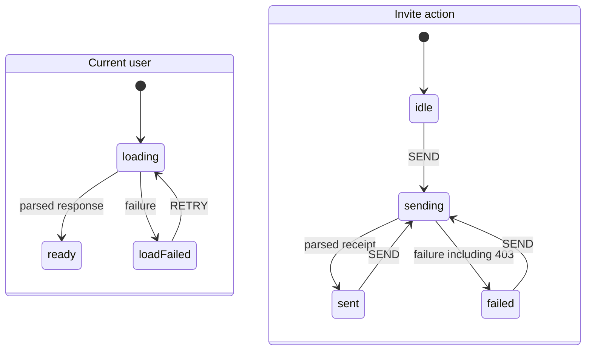

# Project structure and API boundaries

Read this guide before you move code between features, add an endpoint, change a permission or change HTTP error handling. Keep the project's existing conventions and installed tools. Do not add a library only because an example uses it.

## Place code by its owner

- `app/` holds routes, the router and application providers.
- A feature folder holds one business capability.
- Shared folders hold code that several features use. A component that several features use belongs in `src/components/`. A component specific to one feature belongs in that feature's `components/`. Otherwise, colocate it with its consumer.

Keep related components, hooks, styles and state close to where they are used. Test authoring is outside this skill.

Create a feature folder when at least two of these are true: it has its own routes or pages, it has its own endpoints, and it has components not shared elsewhere. Otherwise, extend an existing feature or put genuinely shared code in its shared owner. Create only the folders the feature needs. Name files and folders in kebab-case. Do not create a feature `index.ts` barrel; import source files directly.

**Good example — `structure-owner-tree`.** `team-members` has a page, endpoints and private components, so it is a feature. The invite preview has one user, so it stays beside its form. Billing and members reuse the shared person summary; they do not rebuild it from low-level parts. The tree places existing responsibilities; it does not prescribe speculative folders.

```text
src/
├── app/
│   ├── router.tsx                   # Routes compose feature files directly
│   └── providers.tsx                # Application providers
├── assets/
│   └── brand-mark.svg               # Static assets
├── components/
│   └── person-summary.tsx           # Shared avatar-and-name markup, props only
├── config/
│   └── environment.ts               # Global configuration
├── features/
│   ├── team-members/
│   │   ├── api/
│   │   │   └── get-members.ts        # Schema/decoder, fetcher and endpoint hook
│   │   ├── components/
│   │   │   ├── members-page.tsx
│   │   │   └── invite-form/
│   │   │       ├── invite-form.tsx
│   │   │       ├── invite-preview.tsx
│   │   │       └── invite-form.module.css
│   │   ├── hooks/
│   │   │   └── use-member-selection.ts
│   │   ├── stores/
│   │   │   └── invite-machine.ts
│   │   ├── types/
│   │   │   └── member.ts
│   │   └── utils/
│   │       └── can-invite.ts
│   └── billing/
│       ├── api/
│       │   └── get-seat-usage.ts
│       └── components/
│           └── seat-holders.tsx
├── hooks/
│   └── use-media-query.ts           # Shared hook
├── lib/
│   └── api-client.ts                # One Fetch wrapper, no feature imports
├── stores/
│   └── theme.ts                    # Existing application UI state
├── testing/
│   └── render-app.tsx              # Existing shared test utilities
├── types/
│   └── money.ts                    # Shared domain type
└── utils/
    └── format-money.ts             # Shared utility
```

## Keep imports one-way

Imports point downward: `app → features → shared`.

- A feature imports its own files and shared code, never another feature and never `app/`.
- Shared code imports neither features nor `app/`.
- An app-level page may compose two features. A feature must not reach into its neighbour, also not through a barrel.
- Do not disable an existing boundary lint rule to let an import through.

Keep endpoint code in the feature that owns the endpoint. Moving a presentational component to shared code does not move its fetcher. Each consuming feature supplies the data from its own response, or through a feature-local wrapper that calls its own hook. If that cannot express the journey, let the app compose the features. This rule is about shared presentation; the parts of a stateful compound widget may read their own root's context, as [composition.md](composition.md) describes.

**Good example — `structure-shared-data`.** This isolated module groups logical files and shows every definition. In the tree above, `PersonSummary` is shared, the adapters stay feature-local, and `TeamOverview` composes at app level. Feature routes or endpoint hooks supply the responses; the shared markup fetches nothing.

```tsx
// example: structure-shared-data
export type Person = Readonly<{ id: string; name: string; avatarUrl: string }>;

// src/components/person-summary.tsx
export function PersonSummary({ person }: { person: Person }) {
  return (
    <figure>
      
      <figcaption>{person.name}</figcaption>
    </figure>
  );
}

// src/features/team-members/components/member-summary.tsx
export function MemberSummary({ member }: { member: Person }) {
  return <PersonSummary person={member} />;
}

// src/features/billing/components/seat-holders.tsx
export type SeatUsage = Readonly<{
  holders: ReadonlyArray<Readonly<{ userId: string; displayName: string; avatar: string }>>;
}>;

export function SeatHolders({ usage }: { usage: SeatUsage }) {
  return (
    <section aria-label="Seat holders">
      {usage.holders.map((holder) => (
        <PersonSummary key={holder.userId} person={{
          id: holder.userId, name: holder.displayName, avatarUrl: holder.avatar,
        }} />
      ))}
    </section>
  );
}

// src/app/team-overview.tsx: the app composes features, not the reverse.
export function TeamOverview({ member, usage }: { member: Person; usage: SeatUsage }) {
  return <main><MemberSummary member={member} /><SeatHolders usage={usage} /></main>;
}
```

Use the existing `@/` alias for source imports, not long relative paths. Configure TypeScript's `@/*` path and keep the equivalent bundler alias: TypeScript paths alone do not configure Vite. Keep aliased imports pointed at a file. In the grouped example, the members adapter imports `PersonSummary` from `@/components/person-summary`; the app imports `SeatHolders` from `@/features/billing/components/seat-holders`, never from `@/features/billing`.

**Good example — `structure-typescript-alias`.** The relevant complete minimal `tsconfig.json`:

```json
{
  "compilerOptions": {
    "target": "ES2022",
    "lib": ["ES2022", "DOM", "DOM.Iterable"],
    "module": "ESNext",
    "moduleResolution": "Bundler",
    "jsx": "react-jsx",
    "strict": true,
    "noEmit": true,
    "paths": { "@/*": ["./src/*"] }
  },
  "include": ["src"]
}
```

**Good example — `structure-vite-alias`.** Prerequisite: an existing Vite project with Vite and Node types installed. Merge the alias into the existing config and keep its plugins and settings.

```ts
// example: structure-vite-alias
import { fileURLToPath } from "node:url";
import { defineConfig } from "vite";

export default defineConfig({
  resolve: { alias: { "@": fileURLToPath(new URL("./src", import.meta.url)) } },
});
```

Where ESLint and `eslint-plugin-import` are already installed, enforce one restricted-path zone for each feature, plus app and shared zones. Extend the existing lint mechanism; do not add tools or silence it. If another installed tool enforces the same architecture, keep that tool.

**Good example — `structure-boundary-config`.** A complete flat-config fragment module. Prerequisites: ESLint and `eslint-plugin-import`. Append its exported entries to the existing TypeScript-capable config and keep its parser, resolver and other rules.

```javascript
// example: structure-boundary-config
import importPlugin from "eslint-plugin-import";

const shared = [
  "./src/components", "./src/hooks", "./src/lib", "./src/stores",
  "./src/utils", "./src/types", "./src/config",
];
const features = ["team-members", "billing"];

export default [{
  files: ["src/**/*.{ts,tsx}"],
  plugins: { import: importPlugin },
  rules: {
    "import/no-restricted-paths": ["error", {
      zones: [
        ...features.map((feature) => ({
          target: `./src/features/${feature}`,
          from: "./src/features",
          except: [`./${feature}`],
        })),
        { target: "./src/features", from: "./src/app" },
        { target: shared, from: ["./src/features", "./src/app"] },
      ],
    }],
  },
}];
```

## Keep an endpoint's three pieces together

For every endpoint, colocate:

1. its response schema or hand-written decoder, and its domain type;
2. its Fetch fetcher;
3. its endpoint-specific hook.

The fetcher returns parsed domain data, not an untyped JSON object and not a cast. Decode an unknown role or permission to a value that grants nothing. Use a schema library for the validator and derived type only if it is already installed; Zod and TanStack Query are conditional choices, not dependencies to add.

The feature folder is the module boundary; its public surface is what shared code or an app page imports from it. A parsed response whose shape is already the app's own is already a domain type. Map it only when the shapes differ, for example third-party snake_case fields or storage-only data. Do not add a duplicate type or mapping only because data moves between files in one feature.

Use one thin Fetch wrapper for common status and error behaviour, not axios or interceptors. Fetch resolves on HTTP errors, so check `response.ok` before you treat the body as success. Let the endpoint decode the successful `unknown` body. Keep transport errors, invalid JSON and invalid response shapes on a real failure path.

Use the project's installed data library for server data; [performance.md](performance.md) owns cache and request-deduplication details. With no data library and XState installed, the endpoint hook uses an invoked actor, not loading and error `useState` flags. The frozen-dependency fallback for when neither is installed is in [state-effects.md](state-effects.md). Do not put remote data in a new global UI store.

## Repair the complete permission action

A permission change includes opening and repairing the role fetcher and the HTTP wrapper that the action uses. Do not leave a cast or a 403 sign-out on that path and only mention it in the reply. Do not extend the repair to unrelated endpoints.

Put permission decisions in plain functions and test them without rendering React. A typed role-to-permission map handles role-based gates. When access depends on a specific resource, include its ownership in a plain predicate. A UI gate only decides what to show or enable; it does not stop a crafted request. State in the reply that the server must authenticate the actor, authorise each mutation for that actor and resource, and return 403 before changing data when it refuses access. The client predicate mirrors that rule; it is not its authority.

Keep framework-independent domain and API declarations free of React and actor-framework types: `canInvite` accepts domain values, and fetchers return domain data. Inside UI integration, `ReactNode` slots, ref props and typed actor refs are legitimate contracts between components; do not hide them behind invented neutral wrappers. The example passes a typed invite actor ref from the owning panel to its form; neither the permission predicate nor the fetcher accepts that ref. See [composition.md](composition.md) for `ReactNode` and ref-prop examples.

Show a per-action 403 beside the action that failed. Do not show a global toast, clear the session, sign out or redirect the app. Keep the separate 401 sign-out behaviour. Only a failed route-level access check during navigation justifies an access redirect; do not turn a failed action into navigation. Propagate cancellation unchanged and do not report it as an error. Identify Fetch cancellation by `name === "AbortError"`, not by its JavaScript class. Other failures keep their error path and the project's existing global reporting.

**Good example — `structure-permission-action`.** Prerequisites: React 19, XState 5 and `@xstate/react` 6 installed. No Zod, query library or axios is needed. This is one complete isolated module, grouped by the files it represents: the wrapper; the current-user decoder, fetcher and hook; the invite decoder, fetcher and hook; and the UI. It changes only the endpoints this permission action needs.

- `ApiEffects` are real application ports. Supply the existing sign-out and notification functions to `createApiClient`.
- Call `bindEndpointMachines(client)` once, outside render, at the app boundary.
- The module-scope machines declare typed actor ports; `.provide()` binds the real implementations before either hook can start an actor.
- Keep the client, its application ports and the returned endpoint logic stable while the boundary is mounted.

```tsx
// example: structure-permission-action
import { useState } from "react";
import { useActorRef, useSelector } from "@xstate/react";
import { assign, fromPromise, setup, type ActorRefFrom, type PromiseActorLogic } from "xstate";

// src/lib/api-client.ts
export interface ApiEffects {
  signOut(): void;
  reportError(message: string): void;
}

export class HttpError extends Error {
  constructor(public readonly status: number, message: string) {
    super(message);
    this.name = "HttpError";
  }
}

export function isAbortError(error: unknown): boolean {
  return typeof error === "object" && error !== null &&
    "name" in error && error.name === "AbortError";
}

function messageOf(error: unknown): string {
  return error instanceof Error ? error.message : String(error);
}

function errorMessage(body: unknown, status: number): string {
  return typeof body === "object" && body !== null &&
    "message" in body && typeof body.message === "string"
    ? body.message : `Request failed (${status})`;
}

export interface ApiClient {
  (path: string, init: RequestInit): Promise<Response>;
}

export function createApiClient(effects: ApiEffects): ApiClient {
  return async (path: string, init: RequestInit): Promise<Response> => {
    try {
      const response = await fetch(path, init);
      if (!response.ok) {
        const body: unknown = await response.json().catch((error: unknown) => {
          if (isAbortError(error)) throw error;
          return null;
        });
        throw new HttpError(response.status, errorMessage(body, response.status));
      }
      return response;
    } catch (error: unknown) {
      if (isAbortError(error)) throw error;
      if (error instanceof HttpError && error.status === 403) throw error;
      if (error instanceof HttpError && error.status === 401) effects.signOut();
      effects.reportError(messageOf(error));
      throw error;
    }
  };
}

export type Role = "admin" | "member" | "unknown";
export type CurrentUser = Readonly<{ id: string; teamId: string; role: Role }>;
export type Permission = "invite" | "read";
const permissions: Readonly<Record<Role, ReadonlyArray<Permission>>> = {
  admin: ["read", "invite"], member: ["read"], unknown: [],
};

export function hasPermission(role: Role, permission: Permission): boolean {
  return permissions[role].includes(permission);
}

export function canInvite(user: CurrentUser, teamId: string): boolean {
  return user.teamId === teamId && hasPermission(user.role, "invite");
}

// src/features/team-members/api/get-current-user.ts: schema/decoder and fetcher.
export function parseCurrentUser(value: unknown): CurrentUser {
  if (typeof value !== "object" || value === null ||
      !("id" in value) || typeof value.id !== "string" ||
      !("teamId" in value) || typeof value.teamId !== "string" ||
      !("role" in value)) {
    throw new Error("Invalid current-user response");
  }
  const role: Role = value.role === "admin" || value.role === "member"
    ? value.role : "unknown";
  return { id: value.id, teamId: value.teamId, role };
}

export async function getCurrentUser(
  client: ApiClient, teamId: string, signal: AbortSignal,
): Promise<CurrentUser> {
  const response = await client(`/api/teams/${encodeURIComponent(teamId)}/current-user`, {
    signal,
  });
  const body: unknown = await response.json();
  return parseCurrentUser(body);
}

type TeamInput = Readonly<{ teamId: string }>;
type UserContext = {
  teamId: string; user: CurrentUser | null; error: string | null;
};
type UserEvent = { type: "RETRY" };

function currentUserActor(client: ApiClient) {
  return fromPromise<CurrentUser, TeamInput>(
    ({ input, signal }) => getCurrentUser(client, input.teamId, signal),
  );
}

// Declare the required actor port without a dummy default implementation.
// This private definition is started only after bindCurrentUser supplies it.
const currentUserMachine = setup<
  UserContext, UserEvent, { load: PromiseActorLogic<CurrentUser, TeamInput> },
  {}, {}, {}, never, never, TeamInput
>({}).createMachine({
  id: "current-user",
  context: ({ input }) => ({ teamId: input.teamId, user: null, error: null }),
  initial: "loading",
  states: {
    loading: {
      entry: assign({ error: null }),
      invoke: {
        src: "load",
        input: ({ context }) => ({ teamId: context.teamId }),
        onDone: {
          target: "ready", actions: assign({ user: ({ event }) => event.output }),
        },
        onError: {
          target: "failed", actions: assign({ error: ({ event }) => messageOf(event.error) }),
        },
      },
    },
    ready: {},
    failed: { on: { RETRY: "loading" } },
  },
});

export type CurrentUserMachine = typeof currentUserMachine;

function bindCurrentUser(client: ApiClient): CurrentUserMachine {
  return currentUserMachine.provide({ actors: { load: currentUserActor(client) } });
}

// Third endpoint piece: its hook. Input belongs to this actor's creation.
export function useCurrentUser(machine: CurrentUserMachine, teamId: string) {
  return useActorRef(machine, { input: { teamId } });
}

// src/features/team-members/api/send-invite.ts: schema/decoder and fetcher.
export type InviteReceipt = Readonly<{ id: string; email: string }>;

export function parseInviteReceipt(value: unknown): InviteReceipt {
  if (typeof value !== "object" || value === null ||
      !("id" in value) || typeof value.id !== "string" ||
      !("email" in value) || typeof value.email !== "string") {
    throw new Error("Invalid invite response");
  }
  return { id: value.id, email: value.email };
}

export async function sendInvite(
  client: ApiClient,
  request: Readonly<{ teamId: string; email: string; signal: AbortSignal }>,
): Promise<InviteReceipt> {
  const response = await client(`/api/teams/${encodeURIComponent(request.teamId)}/invites`, {
    method: "POST", headers: { "Content-Type": "application/json" },
    body: JSON.stringify({ email: request.email }), signal: request.signal,
  });
  const body: unknown = await response.json();
  return parseInviteReceipt(body);
}

type InviteInput = Readonly<{ teamId: string; email: string }>;
type InviteContext = {
  teamId: string; email: string; error: string | null; receipt: InviteReceipt | null;
};
type InviteEvent = { type: "SEND"; email: string };

function inviteActor(client: ApiClient) {
  return fromPromise<InviteReceipt, InviteInput>(
    ({ input, signal }) => sendInvite(client, { ...input, signal }),
  );
}

const inviteMachine = setup<
  InviteContext, InviteEvent, { submit: PromiseActorLogic<InviteReceipt, InviteInput> },
  {}, {}, {}, never, never, TeamInput
>({}).createMachine({
  id: "invite",
  context: ({ input }) => ({
    teamId: input.teamId, email: "", error: null, receipt: null,
  }),
  initial: "idle",
  states: {
    idle: { on: { SEND: { target: "sending", actions: assign({
      email: ({ event }) => event.email, error: null, receipt: null,
    }) } } },
    sending: {
      invoke: {
        src: "submit",
        input: ({ context }) => ({ teamId: context.teamId, email: context.email }),
        onDone: { target: "sent", actions: assign({ receipt: ({ event }) => event.output }) },
        onError: { target: "failed", actions: assign({ error: ({ event }) => messageOf(event.error) }) },
      },
    },
    sent: { on: { SEND: { target: "sending", actions: assign({
      email: ({ event }) => event.email, error: null, receipt: null,
    }) } } },
    failed: { on: { SEND: { target: "sending", actions: assign({
      email: ({ event }) => event.email, error: null, receipt: null,
    }) } } },
  },
});

export type InviteMachine = typeof inviteMachine;

function bindInvite(client: ApiClient): InviteMachine {
  return inviteMachine.provide({ actors: { submit: inviteActor(client) } });
}

// Call at application setup, not inside a component or hook.
export function bindEndpointMachines(client: ApiClient): EndpointMachines {
  return { currentUser: bindCurrentUser(client), invite: bindInvite(client) };
}

export interface EndpointMachines {
  readonly currentUser: CurrentUserMachine;
  readonly invite: InviteMachine;
}

// Third endpoint piece: the mutation hook.
export function useSendInvite(machine: InviteMachine, teamId: string) {
  return useActorRef(machine, { input: { teamId } });
}

export type InviteActor = ActorRefFrom<InviteMachine>;

type InvitePanelProps = { endpoints: EndpointMachines; teamId: string };

export function InvitePanel(props: InvitePanelProps) {
  return <InviteJourney key={props.teamId} {...props} />;
}

function InviteJourney({ endpoints, teamId }: InvitePanelProps) {
  const userActor = useCurrentUser(endpoints.currentUser, teamId);
  const inviteActor = useSendInvite(endpoints.invite, teamId);
  const user = useSelector(userActor, (snapshot) => snapshot.context.user);
  const userError = useSelector(userActor, (snapshot) => snapshot.context.error);
  const loading = useSelector(userActor, (snapshot) => snapshot.matches("loading"));

  if (loading) return <p>Loading permissions…</p>;
  if (userError !== null) return <section>
    <p role="alert">{userError}</p>
    <button onClick={() => userActor.send({ type: "RETRY" })}>Retry permissions</button>
  </section>;
  if (user === null || !canInvite(user, teamId)) return <p>You cannot invite team members.</p>;
  return <InviteForm inviteActor={inviteActor} />;
}

export function InviteForm({ inviteActor }: { inviteActor: InviteActor }) {
  const sending = useSelector(inviteActor, (snapshot) => snapshot.matches("sending"));
  const error = useSelector(inviteActor, (snapshot) => snapshot.context.error);
  const receipt = useSelector(inviteActor, (snapshot) => snapshot.context.receipt);
  const [email, setEmail] = useState("");

  return <form onSubmit={(event) => {
    event.preventDefault();
    inviteActor.send({ type: "SEND", email });
  }}>
    <label>Email <input type="email" required value={email}
      onChange={(event) => setEmail(event.currentTarget.value)} /></label>
    <button disabled={sending}>Send invitation</button>
    {error !== null ? <p role="alert">{error}</p> : null}
    {receipt !== null ? <p role="status">Invitation sent to {receipt.email}.</p> : null}
  </form>;
}
```

The actor ignores a second `SEND` while it is sending. Stopping either invoked promise aborts its Fetch signal and discards its late settlement; unmount stops the actor. No cancellation becomes a visible failure after unmount. The only mutable React input is the synchronous email draft. Both machine definitions are at module scope, and each actor receives its team through creation-time `input`, not through a closure or a second state owner.

`InvitePanel` keys its inner journey by `teamId`. A team change stops both old actors, cancels their requests, clears the draft and receipt, and loads the new team's permissions before it shows the form. Changing hook arguments alone does not update a running actor's input; this example deliberately remounts instead of sending an update event.

The app must also key or unmount the containing boundary when the signed-in identity or the API port contract changes; keep `endpoints` stable inside it. Replacing the client or endpoint logic during the same journey is not a supported way to update the actor's dependencies. A 403 still reaches the action actor and renders beside the invite form, and the wrapper calls neither application port for it. A 401 calls sign-out and stays a rejection. An invalid successful response fails in the fetcher; it does not become a granted permission or a claimed successful invite.



**Good example — `structure-route-access-redirect`.** Prerequisite: React Router 7 installed. This navigation loader is not for action submissions. Its injected reader is the application's existing route-access check: it returns a validated decision or rejects when the request fails. Do not convert every thrown HTTP error into a route refusal.

```ts
// example: structure-route-access-redirect
import { redirect, type LoaderFunctionArgs, type RouteObject } from "react-router";

export type RouteAccess = Readonly<{ allowed: boolean }>;
export type ReadRouteAccess = (request: Request) => Promise<RouteAccess>;

export function createTeamRoute(readAccess: ReadRouteAccess): RouteObject {
  return {
    path: "/team",
    loader: async ({ request }: LoaderFunctionArgs): Promise<RouteAccess> => {
      const access = await readAccess(request);
      if (!access.allowed) throw redirect("/access-denied");
      return access;
    },
  };
}
```

**Good example — `structure-pure-permission-tests`.** Prerequisite: Vitest installed. These pure predicates and tests need no React renderer. Resource ownership stays separate from role-only gating, and both are subordinate to server authorisation. This example defines predicates, not another endpoint.

```ts
// example: structure-pure-permission-tests
import { expect, test } from "vitest";

export type Role = "admin" | "editor" | "viewer" | "unknown";
export type Permission = "read" | "write" | "delete";
export type User = Readonly<{ id: string; role: Role }>;
export type Comment = Readonly<{ authorId: string }>;
const permissions: Readonly<Record<Role, ReadonlyArray<Permission>>> = {
  admin: ["read", "write", "delete"], editor: ["read", "write"],
  viewer: ["read"], unknown: [],
};

export function parsePermission(value: unknown): Permission | null {
  return value === "read" || value === "write" || value === "delete" ? value : null;
}

export function hasPermission(role: Role, permission: Permission | null): boolean {
  return permission !== null && permissions[role].includes(permission);
}

export function canDeleteComment(user: User, comment: Comment): boolean {
  return user.role !== "unknown" &&
    (user.id === comment.authorId || hasPermission(user.role, "delete"));
}

test("a role grants only its listed permissions", () => {
  expect(hasPermission("editor", "write")).toBe(true);
  expect(hasPermission("viewer", "delete")).toBe(false);
  expect(hasPermission("unknown", "read")).toBe(false);
  expect(hasPermission("admin", parsePermission("publish"))).toBe(false);
  expect(hasPermission("admin", parsePermission("delete"))).toBe(true);
});

test("comment deletion checks the specific owner or an admin", () => {
  const comment = { authorId: "author-1" };
  expect(canDeleteComment({ id: "author-1", role: "editor" }, comment)).toBe(true);
  expect(canDeleteComment({ id: "other", role: "admin" }, comment)).toBe(true);
  expect(canDeleteComment({ id: "other", role: "editor" }, comment)).toBe(false);
  expect(canDeleteComment({ id: "author-1", role: "unknown" }, comment)).toBe(false);
});
```

## Contain rendering failures

Put local error boundaries around independently useful UI regions, in addition to a root boundary. A boundary catches render and lifecycle failures below it; it does not replace handling a rejected request in the action actor. A failed dashboard must not remove the working sidebar.

**Good example — `structure-local-error-boundaries`.** React alone supplies the boundary. Inject the existing error reporter; do not add a tracking package.

```tsx
// example: structure-local-error-boundaries
import { Component, useState, type ErrorInfo, type ReactNode } from "react";

export type ErrorReporter = (error: Error, info: ErrorInfo) => void;
type BoundaryProps = { children: ReactNode; fallback: ReactNode; report: ErrorReporter };
type BoundaryState = { failed: boolean };

export class RegionBoundary extends Component<BoundaryProps, BoundaryState> {
  state: BoundaryState = { failed: false };
  static getDerivedStateFromError(): BoundaryState { return { failed: true }; }
  componentDidCatch(error: Error, info: ErrorInfo): void { this.props.report(error, info); }
  render(): ReactNode { return this.state.failed ? this.props.fallback : this.props.children; }
}

export function Sidebar() {
  const [open, setOpen] = useState(false);
  return <aside>
    <button onClick={() => setOpen((value) => !value)} aria-expanded={open}>Team links</button>
    {open ? <nav><a href="/team/members">Members</a></nav> : null}
  </aside>;
}

export function Dashboard({ seats }: { seats: number }) {
  if (!Number.isFinite(seats) || seats < 0) throw new Error("Invalid dashboard seat count");
  return <section aria-label="Dashboard"><p>{seats} seats</p></section>;
}

export function TeamApp({ seats, report }: { seats: number; report: ErrorReporter }) {
  return <RegionBoundary report={report} fallback={<p role="alert">The app could not render.</p>}>
    <div>
      <Sidebar />
      <main>
        <RegionBoundary report={report} fallback={<p role="alert">Dashboard unavailable.</p>}>
          <Dashboard seats={seats} />
        </RegionBoundary>
      </main>
    </div>
  </RegionBoundary>;
}
```

## Respect installed tooling

Keep the project's existing type checks, formatting, linting and hooks. Do not require or add ESLint, Prettier, Husky or lint-staged. Use the project's declared scripts; do not invent a second toolchain. A tool that is not installed is a prerequisite gap: it does not permit you to add the tool or to report its check as passed.

**Good example — `structure-existing-tooling`.** In a project with TypeScript 6 (shipped as `tsc6`), Vitest and Vite, and with no ESLint, Prettier, Husky or lint-staged, run the declared checks with the installed binaries:

```sh
./node_modules/.bin/tsc6 --noEmit
./node_modules/.bin/vitest run
./node_modules/.bin/vite build
```

These commands are for the agent that integrates the change; they are not claimed results. Token-storage recommendations, input-sanitising policy and mandatory pre-commit tooling are outside this skill's scope.
